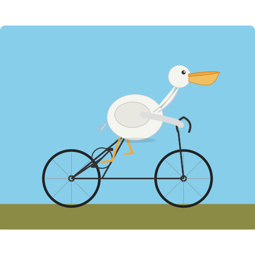
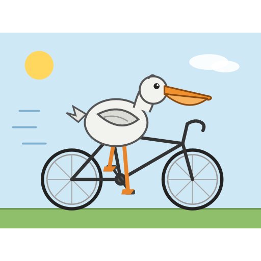
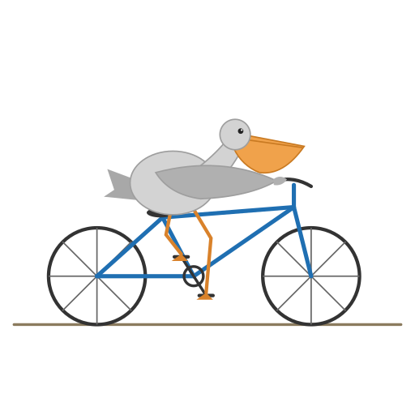
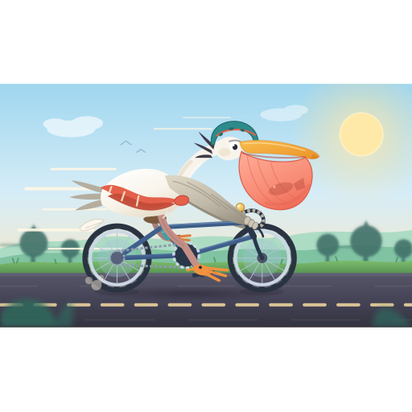
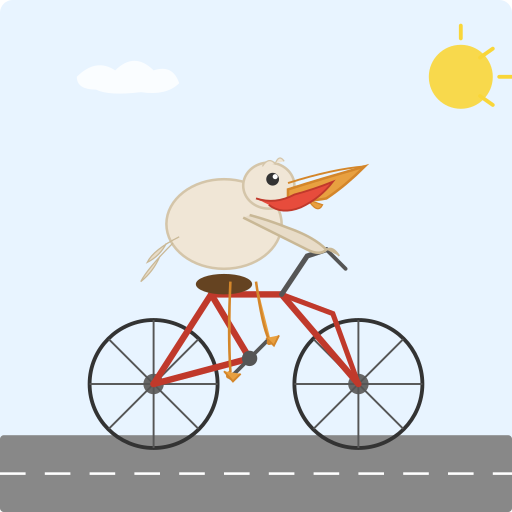
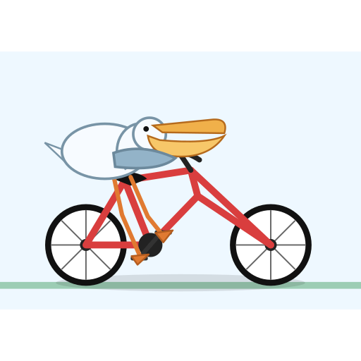
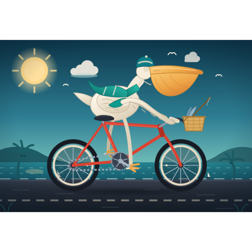
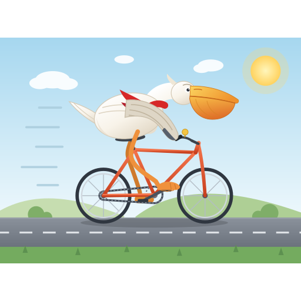
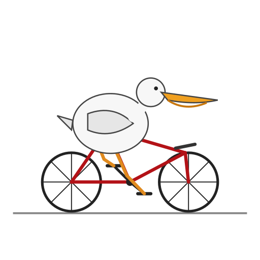
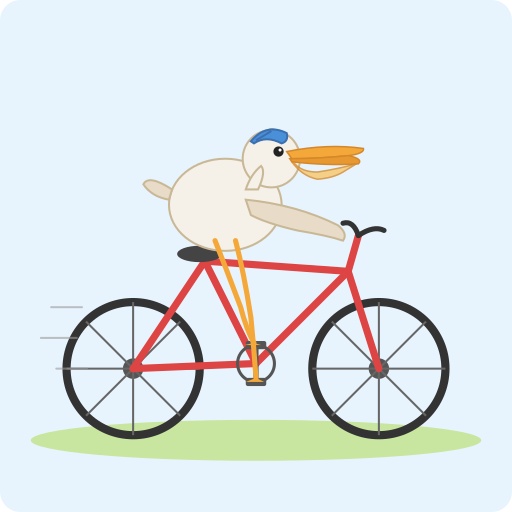

[All AI ratings](AI-RATINGS.md) · [Previous](AI-RATINGS-P175-P215.md) · [Next](AI-RATINGS-P312-P383.md)

# AI ratings: P224–P303

[Comparison tables](AI-RESULTS.md) · [Rubric and provenance](JUDGING.md)

Original judgments, not normalized. P/B/R/C = pelican / bicycle / riding contact / composition (each 0–2).
The human grade is overall 1–10; no human rubric sub-scores were recorded. P231 was not AI-rated.

## P224

**sc-exl3-2.05-h8-low-s11** · Human **1/10** · 66.6 s

| Judge | Overall | P/B/R/C | Text reported | Original explanation |
|---|---:|---|---|---|
| astra | 3 | 1/1/1/1 | false | Circular bird with hollow neck and small bill hovers over skeletal malformed bicycle; bent feet lack clear pedal connections. |
| sol | 4 | 1/1/1/1 | false | Round bird with short pouch-like bill and open neck outlines; bicycle crank misplaced near rear wheel and incomplete frame weaken riding. |
| luna | 4 | 1/1/1/1 | false | Long-billed bird but pouch is subtle; bicycle frame lacks clear conventional structure, and limbs do not show a convincing ride. |
| sonnet | 5 | 2/1/1/1 | false | Pelican with pouch and arm to bars, but bicycle frame is broken and tangled, legs tiny, body floating well above seat. |
| haiku | 4 | 1/2/1/2 | false | Flat short bill, little pouch, so weakly pelican; bicycle frame is odd but readable; body sits awkwardly over frame, wing reaches bars. |

## P230

**gguf-iq3_xxs-medium-s22** · Human **2/10** · 31.3 s

| Judge | Overall | P/B/R/C | Text reported | Original explanation |
|---|---:|---|---|---|
| astra | 6 | 2/2/1/2 | false | Bold readable pelican and bicycle with feet near pedals; folded wing never engages handlebars, giving a static perched impression. |
| sol | 6 | 2/2/1/2 | false | Readable pouch-billed bird and black bicycle with feet near pedals; folded wing and upright posture offer no steering contact. |
| luna | 8 | 2/2/2/2 | false | Distinct bill and pouch, full bicycle, and visible feet at crank; clean, straightforward composition. |
| sonnet | 7 | 2/2/1/2 | false | Pelican with pouch on dark bicycle, legs on pedals, speed lines, sun; body covers frame, no hand on bars, short neck. |
| haiku | 6 | 2/2/1/2 | false | Bill with lower pouch reads as pelican; clean bike; body sits above frame, legs reach pedals, no arms or seat contact. |

## P233

**sc-exl3-2.05-h8-medium-s22** · Human **4/10** · 83.5 s

| Judge | Overall | P/B/R/C | Text reported | Original explanation |
|---|---:|---|---|---|
| astra | 7 | 2/2/2/2 | false | Simple gray pelican with clear orange pouch; bent legs meet pedals and extended wing touches bars on a coherent bicycle. |
| sol | 8 | 2/2/2/2 | false | Readable large pouch, balanced frame and convincing bent legs on opposite pedals; restrained clean illustration. |
| luna | 7 | 2/2/1/2 | false | Bill and pouch make the pelican clear, and bike frame is complete; angular dangling legs make riding slightly awkward. |
| sonnet | 7 | 2/2/2/2 | false | Gray pelican with pouch on blue bicycle, wing to bars, legs on pedals; clean, simple, short neck, plain background. |
| haiku | 6 | 2/2/1/2 | false | Pouch bill reads as pelican; clean bike; body sits above the top tube, legs reach pedals, wing reaches bars; seat contact is unclear. |

## P250

**sc-exl3-2.05-h8-high-s22** · Human **8/10** · 1013.5 s

| Judge | Overall | P/B/R/C | Text reported | Original explanation |
|---|---:|---|---|---|
| astra | 8 | 2/2/1/2 | false | Elaborate pelican with translucent pouch and strong handlebar grip; dynamic scene, but splayed foot extends beyond pedal and details crowd the bike. |
| sol | 9 | 2/2/2/2 | false | Detailed dynamic pelican with translucent fish-filled pouch, helmet and steering contact; layered bicycle scene has strong personality despite tangled feet. |
| luna | 9 | 2/2/2/2 | false | Very clear large pelican pouch, cyclist helmet, detailed bicycle and legs at pedals; composition is richly polished. |
| sonnet | 9 | 2/2/2/2 | false | Detailed pelican with helmet, scarf and pouch with fish, blue bike, road, trees, sun, motion lines; wing and legs slightly tangled but vivid. |
| haiku | 9 | 2/2/2/2 | false | Clear pelican with pouch holding a fish and helmet; seated on bike, legs to pedals, hands on bars; detailed road scene. |

## P255

**gyro-s-tq1_0-low-s33** · Human **4/10** · 31.2 s

| Judge | Overall | P/B/R/C | Text reported | Original explanation |
|---|---:|---|---|---|
| astra | 8 | 2/2/2/2 | false | Clear pouch and bicycle, wing reaches handlebars; feet sit near pedals in a clean cheerful scene. |
| sol | 5 | 2/2/1/1 | false | Long open bill and red pouch suggest pelican, but legs detach from hovering body; crooked front frame and saddle gap undermine riding. |
| luna | 8 | 2/2/2/2 | false | Long bill and visible pouch identify pelican; complete bicycle and feet connect to pedals in a clean roadway scene. |
| sonnet | 5 | 1/2/1/1 | false | Round bird with long beak and red open mouth, arm on bars; body floats above seat, legs dangle. Bike clear; pelican only loosely. |
| haiku | 4 | 1/2/1/1 | false | Pointed beak with red inner, no clear pouch; bike is clear; legs are loose lines, arm reaches bars, body floats over frame. |

## P282

**gguf-iq3_xxs-high-s44** · Human **4/10** · 238.3 s

| Judge | Overall | P/B/R/C | Text reported | Original explanation |
|---|---:|---|---|---|
| astra | 6 | 2/2/1/1 | false | Large pouch identifies pelican, but compressed head-wing overlap and elongated malformed front frame make an awkward riding composition. |
| sol | 7 | 2/2/2/2 | false | Large pouch and low riding posture are clear; feet touch crank and wing reaches bars, though oversized fork and bill feel unbalanced. |
| luna | 7 | 2/2/2/1 | false | Pelican and bicycle are clear with feet at pedals, though the frame geometry is odd and scene is plain. |
| sonnet | 8 | 2/2/2/2 | false | Tucked pelican with big pouch, red bicycle, legs on pedals, shadow; no neck visible but charming and clean. |
| haiku | 5 | 2/2/1/1 | false | Pouch bill reads as pelican; frame has odd geometry; body and head overlap the frame, legs reach pedals, no bar contact. |

## P290

**sc-exl3-2.05-h8-high-s33** · Human **8/10** · 1187.6 s

| Judge | Overall | P/B/R/C | Text reported | Original explanation |
|---|---:|---|---|---|
| astra | 8 | 2/2/1/2 | false | Rich night scene and emphatic pelican pouch; detailed bike, though pale straight legs and long handlike wing weaken natural pedaling. |
| sol | 8 | 2/2/2/2 | false | Stylish dark scenic palette and obvious pelican pouch; seated rider reaches bars and crank, though pale stick legs and hidden eye reduce expression. |
| luna | 9 | 2/2/2/2 | false | Prominent pelican pouch and bill, detailed bicycle, feet on pedals, and striking night-road composition. |
| sonnet | 10 | 2/2/2/2 | false | Excellent: helmeted scarfed pelican with big pouch, bike with basket and chain, coastal road, palms, sun, gulls; arm on bars, riding. |
| haiku | 9 | 2/2/2/2 | false | Large pouch, cap and scarf make a clear pelican; seated on saddle, legs to pedals, arm on bars; well-arranged harbour scene. |

## P298

**gguf-iq3_s-high-s11** · Human **8/10** · 419.4 s

| Judge | Overall | P/B/R/C | Text reported | Original explanation |
|---|---:|---|---|---|
| astra | 9 | 2/2/2/2 | false | Expressive pelican leans over handlebars with articulated pedaling legs; warm layered feather shapes and clean bicycle create a convincing scene. |
| sol | 9 | 2/2/2/2 | false | Expressive streamlined pelican, distinctive pouch, natural bent pedaling legs and wing on bars; polished cheerful countryside scene. |
| luna | 9 | 2/2/2/2 | false | Expressive pelican with bill and pouch rides a clear bicycle; legs extend to pedals in a complete road scene. |
| sonnet | 9 | 2/2/2/2 | false | Polished: pelican with large pouch, scarf, orange bike with chain, road, hills, sun, speed lines; neck tucked and wing a bit odd. |
| haiku | 8 | 2/2/2/2 | false | Big pouch bill and wing on bars make a clear pelican; seated on saddle, legs to pedals; road scene is clean. |

## P302

**gyro-m-tq2_0-medium-s33** · Human **1/10** · 31.6 s

| Judge | Overall | P/B/R/C | Text reported | Original explanation |
|---|---:|---|---|---|
| astra | 5 | 1/2/1/2 | false | Readable bird on bicycle with pedal contact, but shallow beak pouch, disconnected neck contour and no handlebar reach reduce specificity. |
| sol | 5 | 2/2/1/1 | false | Large pouch-billed bird obscures bicycle, head-neck join is broken and no wing reaches bars; feet at least meet pedals. |
| luna | 8 | 2/2/2/2 | false | Pouch and bill clearly identify pelican; complete bicycle and feet at crank make the riding pose readable. |
| sonnet | 6 | 2/2/1/1 | false | Pelican with beak and slight pouch, but huge body hides frame, no neck, legs stubby; bicycle clear. |
| haiku | 5 | 2/2/1/2 | false | Bill with a pouch curve reads as pelican; bike clean; body sits on top of frame with legs to pedals, no arms to bars. |

## P303

**gguf-iq3_s-low-s11** · Human **3/10** · 37.4 s

| Judge | Overall | P/B/R/C | Text reported | Original explanation |
|---|---:|---|---|---|
| astra | 5 | 1/2/1/2 | false | Round bird with stacked oval bill looks ducklike; wing stops short of bars and parallel legs crowd the central crank. |
| sol | 8 | 2/2/2/2 | false | Clean friendly pelican with open pouch, seated over saddle and feet on crank; wing nearly reaches handlebar. |
| luna | 7 | 2/2/1/2 | false | Pelican and bicycle are clear; bird is perched over the rear frame, with legs reaching pedals but awkwardly positioned. |
| sonnet | 7 | 2/2/2/2 | false | Cute pelican with cap and small pouch seated on red bicycle, legs on pedals, wing to bars; neck missing, simple. |
| haiku | 5 | 1/2/2/2 | false | Bill is flat with no clear throat pouch, so weakly pelican; bike clean; seated on saddle, legs reach pedals, arm reaches forward. |

[All AI ratings](AI-RATINGS.md) · [Previous](AI-RATINGS-P175-P215.md) · [Next](AI-RATINGS-P312-P383.md)
