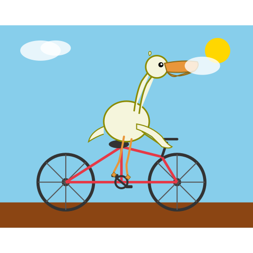
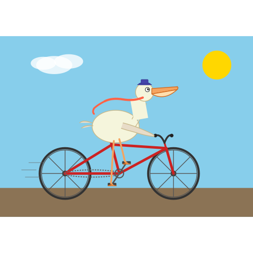
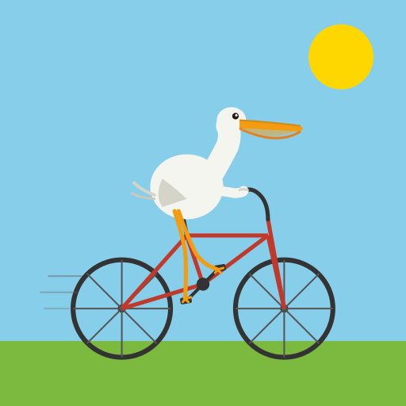
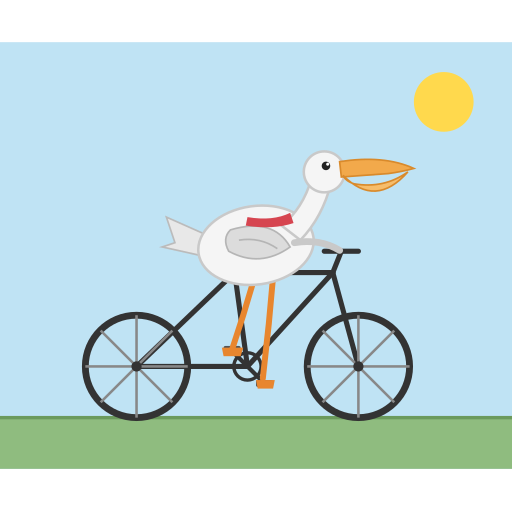
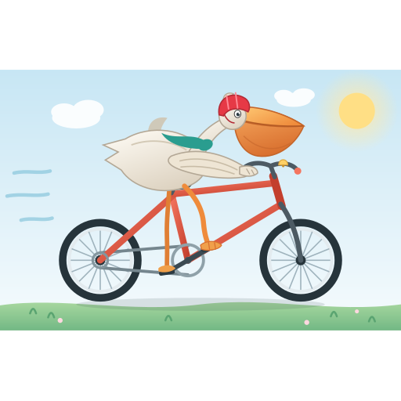
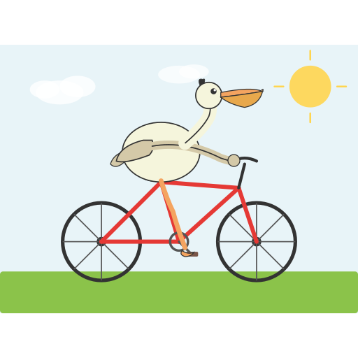
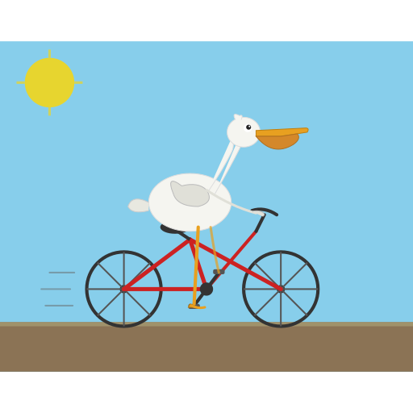
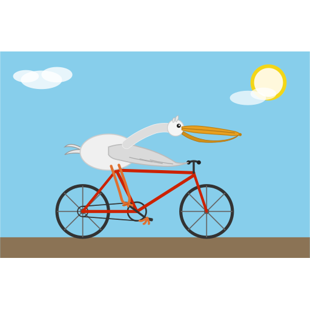
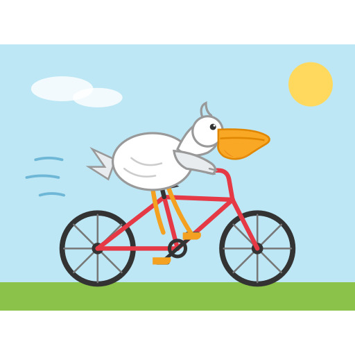

[All AI ratings](AI-RATINGS.md) · [Previous](AI-RATINGS-P386-P416.md) · [Next](AI-RATINGS-P509-P581.md)

# AI ratings: P425–P507

[Comparison tables](AI-RESULTS.md) · [Rubric and provenance](JUDGING.md)

Original judgments, not normalized. P/B/R/C = pelican / bicycle / riding contact / composition (each 0–2).
The human grade is overall 1–10; no human rubric sub-scores were recorded. P231 was not AI-rated.

## P425

**sc-exl3-2.05-h8-low-s44** · Human **3/10** · 58.2 s

| Judge | Overall | P/B/R/C | Text reported | Original explanation |
|---|---:|---|---|---|
| astra | 4 | 1/2/1/1 | false | Thin open neck and cloud obscuring beak weaken pelican identity; wing misses bars and feet bunch at crank. |
| sol | 7 | 2/2/2/2 | false | Clear pouch and bicycle, feet reach crank; simple shapes and cloud overlapping beak reduce polish. |
| luna | 6 | 1/2/2/1 | false | Bird has long bill but pouch is barely visible; bicycle and pedal contact are clear, with awkward anatomy. |
| sonnet | 5 | 2/1/1/1 | false | Long-necked pelican with pouch sits on seat, but bicycle frame is malformed (no bars or proper tubes), wing not on bars, cloud overlaps beak. |
| haiku | 6 | 1/2/2/2 | false | Long swan-like neck and flat bill with weak pouch; bicycle complete; saddle, pedals and wing on bars all touch. |

## P431

**td-exl3-2.68-h6-ng8-low-s44** · Human **6/10** · 101.6 s

| Judge | Overall | P/B/R/C | Text reported | Original explanation |
|---|---:|---|---|---|
| astra | 7 | 2/2/2/2 | false | Clear pouch, playful hat and scarf, and evident pedal/bar contacts; angular neck and straight legs keep it visually basic. |
| sol | 6 | 2/2/2/1 | false | Pouch-billed bird touches bars and pedals on clear bicycle, but angular disconnected-looking neck and sparse body details diminish polish. |
| luna | 7 | 2/2/1/2 | false | Pelican bill and subtle pouch visible, complete bicycle, but feet hang around crank rather than natural pedal posture. |
| sonnet | 7 | 2/2/2/2 | false | Pelican with hat, scarf and small pouch on red bicycle, legs on pedals, wing to bars; neck blocky, simple scene. |
| haiku | 4 | 1/2/1/1 | false | Short beak with no real pouch, so weakly pelican; bike is clear; body floats over frame, a loose red streak and detached arm look odd. |

## P437

**sc-exl3-3.05-h8-low-s22** · Human **7/10** · 86.1 s

| Judge | Overall | P/B/R/C | Text reported | Original explanation |
|---|---:|---|---|---|
| astra | 7 | 2/2/2/2 | false | Recognizable long bill and pouch, wing grips curved bars and bent legs meet pedals; plain but coherent bright scene. |
| sol | 7 | 2/2/2/2 | false | Legs align with crank and wing touches bar; recognizable pelican despite thin pouch and very simplified body. |
| luna | 7 | 1/2/2/2 | false | Long bill with faint pouch suggests a pelican; bicycle is clear and legs contact frame and crank in a simple scene. |
| sonnet | 8 | 2/2/2/2 | false | Clean flat pelican with long beak, pouch and neck, hand on bars, legs on pedals, red bicycle, sun, grass, speed lines. |
| haiku | 5 | 1/2/1/2 | false | Long bill but no clear throat pouch, so weakly pelican; clean bike; body floats above frame, feet reach pedals, wing reaches bars. |

## P442

**gyro-m-tq2_0-medium-s11** · Human **3/10** · 40.9 s

| Judge | Overall | P/B/R/C | Text reported | Original explanation |
|---|---:|---|---|---|
| astra | 7 | 2/2/2/2 | false | Simple pelican and bicycle read well with wing at bars and feet at crank ends, though stiff legs reduce dynamism. |
| sol | 8 | 2/2/2/2 | false | Recognizable pouch, balanced bicycle, seated body and wing reaching bars; feet somewhat loosely aligned with pedals. |
| luna | 8 | 2/2/2/2 | false | Pelican bill and pouch are clear; bicycle is complete and feet reach crank and pedals in a simple scene. |
| sonnet | 8 | 2/2/2/2 | false | Clean pelican with scarf, pouch, seated on dark bicycle, hand on bars, legs on pedals; sun and grass. |
| haiku | 6 | 2/2/1/2 | false | Bill with lower pouch reads as pelican; clean bike; body sits over the top tube, wing reaches bars, legs to pedals, no saddle. |

## P450

**sc-exl3-3.05-h8-high-s22** · Human **8/10** · 623.6 s

| Judge | Overall | P/B/R/C | Text reported | Original explanation |
|---|---:|---|---|---|
| astra | 8 | 2/2/2/2 | false | Large clear pouch, expressive face and good pedal stance; wing nearly reaches bars, with pleasing clean landscape and bicycle detail. |
| sol | 8 | 2/2/2/2 | false | Expressive helmeted pelican with deep pouch, clear steering and pedal contact; graceful bicycle scene, though wheels hover slightly above ground. |
| luna | 9 | 2/2/2/2 | false | Very clear pouch and pelican profile, full detailed bicycle, feet on pedals, and attractive sunny landscape. |
| sonnet | 10 | 2/2/2/2 | false | Excellent: helmeted scarfed pelican with big pouch, detailed bike with bell and chain, wing on bars, meadow, sun, speed lines. |
| haiku | 8 | 2/2/2/2 | false | Pouch bill and helmet read as pelican; seated over frame, legs to pedals, wing reaches bars; detailed bike and meadow scene. |

## P463

**td-exl3-2.68-h6-ng8-low-s33** · Human **4/10** · 86.5 s

| Judge | Overall | P/B/R/C | Text reported | Original explanation |
|---|---:|---|---|---|
| astra | 6 | 2/2/1/2 | false | Simple recognizable pelican and bicycle; round body, single merged leg and arm-like wing make contact stiff rather than natural. |
| sol | 6 | 2/2/1/2 | false | Pelican pouch and bicycle are readable; stretched humanlike steering arm and merged single leg make contact awkward despite tidy composition. |
| luna | 8 | 2/2/2/2 | false | Long bill and throat pouch distinguish the pelican; complete bicycle and seated posture with foot at pedal read clearly. |
| sonnet | 7 | 2/2/2/2 | false | Pelican with curved neck and small pouch on red bicycle, hand on bars, leg on pedal, sun, clouds; clean, body floats a bit. |
| haiku | 6 | 2/2/1/2 | false | Bill with lower pouch reads as pelican; clean bike; body sits above frame, arm reaches bars, one leg reaches pedal, no seat contact. |

## P472

**td-exl3-2.68-h6-ng8-low-s11** · Human **2/10** · 87.5 s

| Judge | Overall | P/B/R/C | Text reported | Original explanation |
|---|---:|---|---|---|
| astra | 5 | 2/1/2/1 | false | Pouch and seated pedaling bird read clearly, but open sticklike neck and missing front fork make the drawing structurally weak. |
| sol | 5 | 2/2/1/1 | false | Pouch identifies pelican, but neck is nearly empty outlines and bicycle tubes cross implausibly; thin feet and steering contact remain awkward. |
| luna | 8 | 2/2/2/2 | false | Clearly pouch-billed pelican on a complete bicycle; legs meet crank and the restrained landscape is well arranged. |
| sonnet | 7 | 2/2/2/2 | false | Pelican with pouch and very long neck seated on red bicycle, legs on pedals, thin arm to bars; clean but thin and simple. |
| haiku | 7 | 2/2/2/2 | false | Recognizable pelican with pouch bill; bicycle complete; body rests on saddle with leg to pedal; simple blob body. |

## P474

**sc-exl3-2.05-h8-high-s55** · Human **9/10** · 530.1 s

| Judge | Overall | P/B/R/C | Text reported | Original explanation |
|---|---:|---|---|---|
| astra | 9 | 2/2/2/2 | false | Polished colorful scene, prominent pouch, bent pedaling legs and wing on bars; helmet obscures much of the face. |
| sol | 9 | 2/2/2/2 | false | Richly finished cycling scene with large throat pouch, bent pedaling legs, scarf and basket; helmet obscures facial detail. |
| luna | 9 | 2/2/2/2 | false | Distinct pelican pouch and beak ride a detailed bicycle; legs reach the pedals, with polished colorful scenery. |
| sonnet | 10 | 2/2/2/2 | false | Excellent: helmeted pelican with pouch, detailed bicycle with basket, landscape, motion lines, convincing riding pose. |
| haiku | 8 | 2/2/2/2 | false | Large pouch bill and cap make a clear pelican; bicycle with basket; legs reach pedals, wing on bars; scene is well arranged. |

## P494

**td-exl3-2.18-h6-ng8-low-s44** · Human **6/10** · 101.7 s

| Judge | Overall | P/B/R/C | Text reported | Original explanation |
|---|---:|---|---|---|
| astra | 7 | 2/2/2/2 | false | Long bill with pouch and low forward riding posture read clearly; simple clean bike, though feet and crank overlap awkwardly. |
| sol | 7 | 2/2/2/2 | false | Long-necked pelican with clear pouch reaches bars and crank; coherent small bicycle, though feet are simplified splayed strokes. |
| luna | 8 | 2/2/2/2 | false | Long bill and pouch distinguish pelican; complete bicycle and feet at pedals in a clear beach-like scene. |
| sonnet | 7 | 2/2/1/2 | false | Long-beaked pelican stretched flat over red bicycle, pouch visible; legs reach pedals, wing near bars, body slightly floating. |
| haiku | 6 | 2/2/1/2 | false | Long bill with lower pouch reads as pelican; clean bike; body floats above top tube, legs reach pedals, no seat contact. |

## P507

**td-exl3-2.68-h6-ng8-medium-s22** · Human **4/10** · 88.3 s

| Judge | Overall | P/B/R/C | Text reported | Original explanation |
|---|---:|---|---|---|
| astra | 5 | 2/2/1/1 | false | Pouch-bearing bird reaches bars, but one leg ends above a detached foot and crowded angular neck weakens anatomy. |
| sol | 5 | 2/2/1/1 | false | Round pouch-billed bird and bicycle read clearly, but one leg ends abruptly and a detached foot hangs near crank. |
| luna | 8 | 2/2/2/2 | false | Pelican bill and pouch are clear, with complete bicycle and feet on pedals in a simple polished scene. |
| sonnet | 8 | 2/2/2/2 | false | Cute pelican with large pouch, red bicycle, wing on bars, legs on pedals, sun, clouds, speed lines; clean and cheerful. |
| haiku | 6 | 2/2/1/2 | false | Clear pelican with orange pouch bill; complete bicycle; body rests on top tube with no saddle, legs reach pedals. |

[All AI ratings](AI-RATINGS.md) · [Previous](AI-RATINGS-P386-P416.md) · [Next](AI-RATINGS-P509-P581.md)
