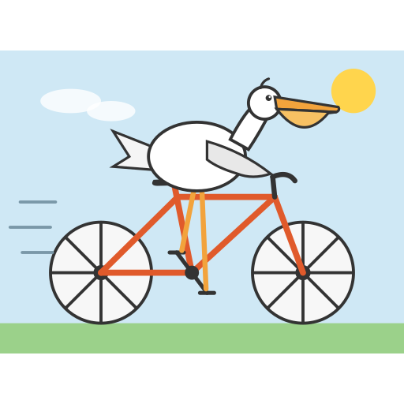
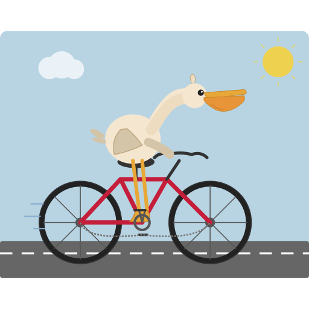
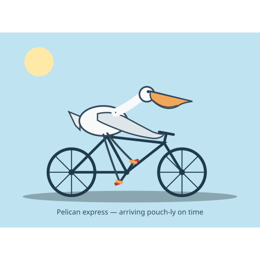
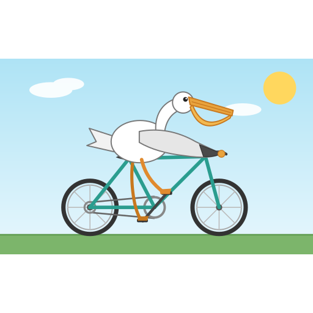
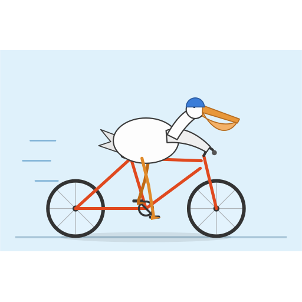
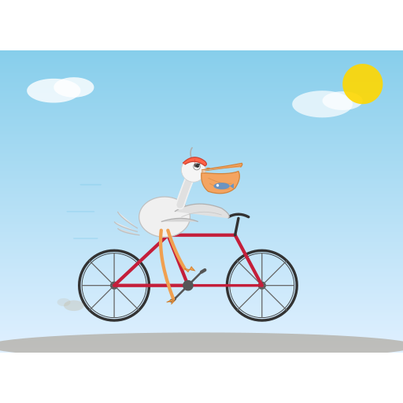
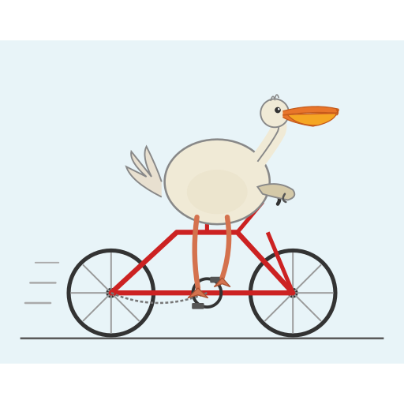
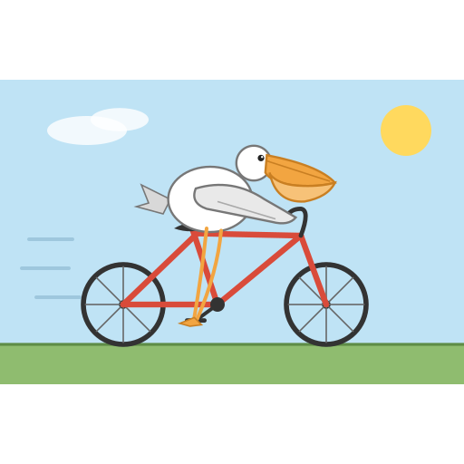
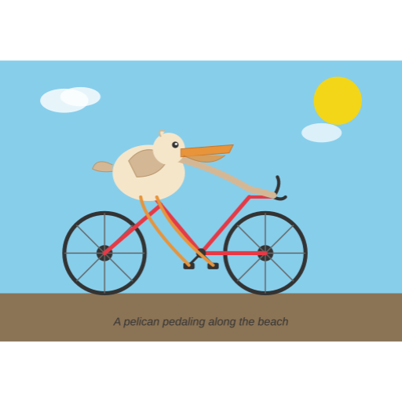
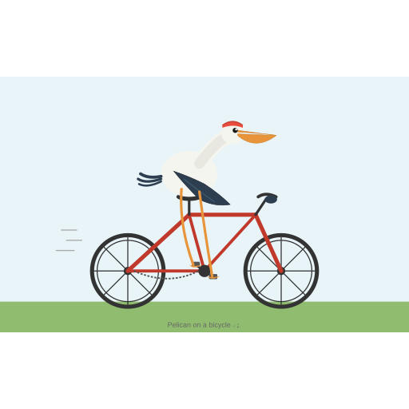

[All AI ratings](AI-RATINGS.md) · [Previous](AI-RATINGS-P509-P581.md) · [Next](AI-RATINGS-P676-P741.md)

# AI ratings: P595–P670

[Comparison tables](AI-RESULTS.md) · [Rubric and provenance](JUDGING.md)

Original judgments, not normalized. P/B/R/C = pelican / bicycle / riding contact / composition (each 0–2).
The human grade is overall 1–10; no human rubric sub-scores were recorded. P231 was not AI-rated.

## P595

**gguf-iq3_s-medium-s55** · Human **6/10** · 32.5 s

| Judge | Overall | P/B/R/C | Text reported | Original explanation |
|---|---:|---|---|---|
| astra | 8 | 2/2/2/2 | false | Bold clear pelican and complete bicycle, wing touches bars and feet meet opposing pedals; balanced simple illustration with stiff neck. |
| sol | 7 | 2/2/2/2 | false | Clear pouch-billed pelican seated over frame, wing reaches bar and feet meet opposing pedals; clean but angular basic illustration. |
| luna | 8 | 2/2/2/2 | false | Pelican pouch and long bill, clear bicycle frame, and legs connected to pedals in a crisp composition. |
| sonnet | 8 | 2/2/2/2 | false | Bold-outlined pelican with pouch on orange bicycle, wing to bars, legs on pedals, sun, clouds, speed lines; clean and legible. |
| haiku | 6 | 2/2/1/2 | false | Bill with lower pouch reads as pelican; clean bike; body sits over the top tube, wing reaches bars, legs to pedals, no saddle. |

## P597

**gguf-iq3_xxs-low-s33** · Human **4/10** · 37.1 s

| Judge | Overall | P/B/R/C | Text reported | Original explanation |
|---|---:|---|---|---|
| astra | 7 | 2/2/1/2 | false | Appealing pelican and bold bicycle, but parallel legs converge awkwardly and handlebar stem appears disconnected. |
| sol | 4 | 2/1/1/1 | false | Recognizable pelican sits above bicycle-like wheels, but broken steering stem, chain routed between wheel hubs and merged feet undermine mechanical coherence. |
| luna | 8 | 2/2/2/2 | false | Clear pelican bill and pouch, full bicycle, and legs down to crank in a neatly framed roadway scene. |
| sonnet | 8 | 2/2/2/2 | false | Pelican with curved neck and pouch seated on crimson bicycle, legs on pedals, arm toward bars, road, sun, cloud; clean. |
| haiku | 8 | 2/2/2/2 | false | Clear pouch bill and long neck; seated on saddle, legs to pedals, wing on bars; clean road scene. |

## P617

**gyro-m-tq2_0-medium-s55** · Human **3/10** · 42.1 s

| Judge | Overall | P/B/R/C | Text reported | Original explanation |
|---|---:|---|---|---|
| astra | 7 | 2/2/2/2 | true | Low forward pelican posture, distinctive pouch and clear bar/pedal contacts; dark legs blend with frame, reducing immediate legibility. |
| sol | 7 | 2/2/2/2 | true | Long pouch bill, steering wing and opposed feet communicate cyclist clearly; clean compact layout, though narrow neck and gray legs are schematic. |
| luna | 8 | 2/2/2/2 | true | Clear pouch-billed pelican rides a well-drawn bicycle with feet on pedals; text is present but disregarded. |
| sonnet | 8 | 2/2/2/2 | true | Stylish low-slung pelican with pouch on navy bicycle, legs on pedals, wing to bars, shadow; clean flat design, caption ignored. |
| haiku | 4 | 1/2/1/2 | true | Wedge bill with little pouch, weakly pelican; bike clean; body rests on top tube, no visible leg or seat contact. Caption ignored. |

## P618

**td-exl3-2.68-h6-ng8-medium-s33** · Human **6/10** · 166.7 s

| Judge | Overall | P/B/R/C | Text reported | Original explanation |
|---|---:|---|---|---|
| astra | 8 | 2/2/2/2 | false | Distinct pouch and curved neck, wing reaches bar and bent legs meet opposing pedals; tidy bicycle and balanced simple setting. |
| sol | 8 | 2/2/2/2 | false | Distinct hanging pouch, smooth curved neck and wing reaching handlebar; feet meet opposed pedals on clean chain-driven bicycle. |
| luna | 8 | 2/2/2/2 | false | Clear pelican bill and pouch with complete bicycle; feet meet pedals and shapes are cleanly arranged. |
| sonnet | 9 | 2/2/2/2 | false | Polished scene: clear pelican with pouch, teal bicycle, legs on pedals, wing on bars, sky and grass. |
| haiku | 6 | 2/2/1/2 | false | Bill with lower pouch reads as pelican; clean bike; body sits over top tube, wing reaches bars, legs to pedals, no saddle. |

## P622

**td-exl3-2.18-h6-ng8-medium-s55** · Human **4/10** · 134.8 s

| Judge | Overall | P/B/R/C | Text reported | Original explanation |
|---|---:|---|---|---|
| astra | 7 | 2/2/2/2 | false | Clear pouch and plausible contacts on a simple bicycle; helmet hides face and angular neck feels mechanical. |
| sol | 7 | 2/2/2/2 | false | Clear pouch, pedaling legs and wing on bar; simple tidy drawing, but head lacks a visible eye. |
| luna | 8 | 2/2/2/2 | false | Pelican bill and pouch are visible, with recognizable bicycle and feet at pedal locations in a clear arrangement. |
| sonnet | 8 | 2/2/2/2 | false | Helmeted pelican with pouch, orange bicycle, arm to bars, legs on pedals, speed lines and shadow; clean. |
| haiku | 5 | 2/2/1/2 | false | Pouch bill and cap read as pelican; bike clean; blank oval body floats above the frame, wing reaches bars, one leg to pedal. |

## P629

**td-exl3-2.18-h6-ng8-low-s11** · Human **3/10** · 117.0 s

| Judge | Overall | P/B/R/C | Text reported | Original explanation |
|---|---:|---|---|---|
| astra | 5 | 2/2/1/1 | false | Pelican has distinctive fish-filled pouch, but tiny cyclist floats above broad ground shadow and feet miss obvious pedal positions. |
| sol | 6 | 2/2/1/2 | false | Recognizable pelican with fish-filled pouch and neat bicycle; feet miss cranks and wheels float above the ground. |
| luna | 7 | 2/2/1/2 | false | Small but recognizable pelican with pouch and bicycle; legs dangle, making riding pose less convincing. |
| sonnet | 9 | 2/2/2/2 | false | Charming scene: pelican with fish in pouch, red cap, clean bicycle, legs on pedals, sun, clouds, motion lines. |
| haiku | 6 | 2/2/1/2 | false | Pouch bill with a fish reads as pelican; bike clean; body sits on top tube with legs to pedals and no clear saddle contact. |

## P640

**gguf-iq3_s-low-s22** · Human **1/10** · 38.7 s

| Judge | Overall | P/B/R/C | Text reported | Original explanation |
|---|---:|---|---|---|
| astra | 4 | 1/1/1/1 | false | Circular generic bird with short bill, detached tail and floating handlike wing; bicycle steering assembly is visibly disconnected. |
| sol | 4 | 1/1/1/1 | false | Round bird with short pouch-like bill above malformed bicycle; detached fork and tail, unclear handlebar and mismatched feet break structure. |
| luna | 7 | 2/2/2/2 | false | Pelican and bicycle are readable, with legs down to pedals; frame has a missing fork segment but overall scene is clean. |
| sonnet | 6 | 2/2/1/1 | false | Pelican with pouch and neck, red bicycle; huge body sits over frame, legs straight down to pedals, hand not on bars, frame broken. |
| haiku | 4 | 2/2/1/1 | false | Pouch bill reads as pelican; bike frame is odd with a broken rear triangle; body floats above frame, legs pass through it. |

## P645

**td-exl3-2.18-h6-ng8-medium-s11** · Human **6/10** · 98.3 s

| Judge | Overall | P/B/R/C | Text reported | Original explanation |
|---|---:|---|---|---|
| astra | 7 | 2/2/1/2 | false | Compact clean pelican with clear pouch and wing at bars, though both legs converge onto one pedal. |
| sol | 6 | 2/2/1/2 | false | Distinct pouch and steering wing on clear red bicycle; legs converge into overlapping feet at one pedal, making riding stiff. |
| luna | 7 | 2/2/1/2 | false | Pouch-billed pelican and bicycle are clear, but only one foot is visible near the crank and pose is awkward. |
| sonnet | 8 | 2/2/2/2 | false | Pelican with big pouch, red bicycle, legs on pedals, wing to bars, speed lines, sun and grass; tidy. |
| haiku | 7 | 2/2/2/2 | false | Clear pouch bill; seated on saddle with wing reaching bars and a leg to the pedal; clean simple scene. |

## P649

**gyro-m-tq2_0-low-s44** · Human **3/10** · 32.7 s

| Judge | Overall | P/B/R/C | Text reported | Original explanation |
|---|---:|---|---|---|
| astra | 4 | 1/1/1/1 | true | Round generic bird with shallow bill; bicycle lacks front fork and coherent crank while legs extend loosely toward separate black marks. |
| sol | 4 | 1/1/1/1 | true | Bird has short bill and round body; bicycle frame lacks convincing saddle and crank structure, with stretched diagonal limb. |
| luna | 7 | 2/2/1/2 | true | Pelican with pouch and bicycle are clear, but feet hover below the frame; caption is present and disregarded. |
| sonnet | 7 | 2/2/2/2 | true | Pelican with pouch, arm to bars, legs reach pedals on red bicycle; seat missing and body floats, simple scene. |
| haiku | 5 | 1/2/1/2 | true | Flat wedge bill with little pouch; bicycle clean; body sits over the frame, arm reaches bars, legs to pedals. Caption ignored. |

## P670

**gyro-m-tq2_0-low-s55** · Human **7/10** · 45.8 s

| Judge | Overall | P/B/R/C | Text reported | Original explanation |
|---|---:|---|---|---|
| astra | 5 | 1/2/1/2 | true | Small generic long-necked bird sits over bicycle; shallow bill and folded wing lack pelican specificity and convincing steering. |
| sol | 6 | 1/2/1/2 | true | Neat bicycle and perched bird, but short bill and minimal pouch weaken pelican identity; wing does not reach steering. |
| luna | 6 | 1/2/1/1 | true | Long bill suggests pelican but pouch is slight; bicycle is clear, while legs cluster awkwardly. Small text ignored. |
| sonnet | 8 | 2/2/2/2 | true | Neat pelican with dark wing, pouch, red crest, red bicycle with chain, seated on pedals and bars; clean flat style, small caption. |
| haiku | 5 | 1/2/1/2 | true | Bill is pelican-like but pouch is faint; bicycle clean; body sits on frame with legs to pedals; caption text ignored. |

[All AI ratings](AI-RATINGS.md) · [Previous](AI-RATINGS-P509-P581.md) · [Next](AI-RATINGS-P676-P741.md)
