# Every AI rating

[Comparison tables](AI-RESULTS.md) · [Rubric and provenance](JUDGING.md)

Original judgments, not normalized. P/B/R/C = pelican / bicycle / riding contact / composition (each 0–2).
The human grade is overall 1–10; no human rubric sub-scores were recorded. P231 was not AI-rated.

## P100

**sc-exl3-2.05-h8-medium-s33** · Human **4/10** · 107.9 s

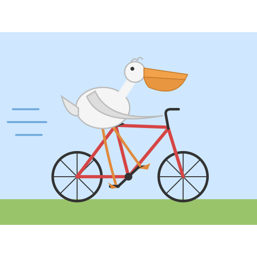

| Judge | Overall | P/B/R/C | Text reported | Original explanation |
|---|---:|---|---|---|
| astra | 7 | 2/2/1/2 | false | Clear pouch and clean bicycle with spread pedaling legs, but narrow wing ends just short of handlebars and saddle is absent. |
| sol | 6 | 2/2/1/2 | false | Clear large pouch and neat bicycle; feet approach crank but thin wing stops short of handlebar, leaving pose somewhat disconnected. |
| luna | 8 | 2/2/2/2 | false | Long bill and pouch make pelican clear; complete bicycle and legs at crank create a convincing, uncluttered ride. |
| sonnet | 8 | 2/2/2/2 | false | Pelican with pouch on red bicycle, wing toward bars, legs on pedals, speed lines, grass; clean and simple. |
| haiku | 6 | 2/2/1/2 | false | Clear pouch bill and clean bicycle; body sits on the top tube with no saddle, legs reach pedals, wing near bars. |

## P106

**sc-exl3-3.05-h8-medium-s44** · Human **6/10** · 73.1 s

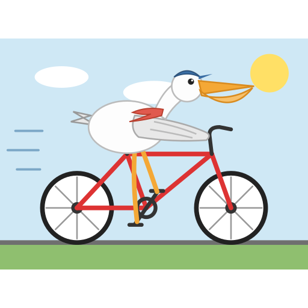

| Judge | Overall | P/B/R/C | Text reported | Original explanation |
|---|---:|---|---|---|
| astra | 8 | 2/2/2/2 | false | Crisp cheerful pelican with pouch, scarf and wing on bars; well-defined bike and opposing pedal positions make riding clear. |
| sol | 8 | 2/2/2/2 | false | Long pouch bill, cap and scarf give personality; broad wing reaches bars and both feet meet pedals on a clean bicycle. |
| luna | 8 | 2/2/2/2 | false | Clear pelican pouch and beak, complete bicycle, and visible foot contacts with pedals in a strong side view. |
| sonnet | 8 | 2/2/2/2 | false | Pelican with pouch, cap and scarf on red bicycle, wing to bars, legs on pedals, sun, clouds, speed lines; clean and legible. |
| haiku | 6 | 2/2/1/2 | false | Pouch bill reads as pelican; clean bike; body sits over the top tube, legs reach pedals, wing near bars, no seat contact. |

## P109

**sc-exl3-2.05-h8-medium-s55** · Human **3/10** · 98.0 s

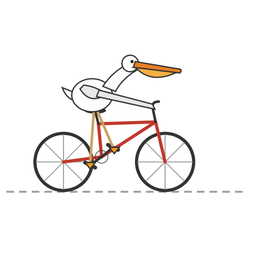

| Judge | Overall | P/B/R/C | Text reported | Original explanation |
|---|---:|---|---|---|
| astra | 7 | 2/2/2/2 | false | Clear long bill and pouch with both feet on pedals and wing reaching bars; unusually small body but coherent minimalist scene. |
| sol | 8 | 2/2/2/2 | false | Crisp pelican profile with pouch, wing on handlebar and feet on pedals; convincing minimalist riding pose. |
| luna | 8 | 2/2/2/2 | false | Distinctive pelican bill and pouch, clear bicycle, and legs at pedals create a convincing, clean side-view ride. |
| sonnet | 8 | 2/2/2/2 | false | Clear pelican with pouch on clean bicycle, seated with legs on pedals, arm on bars; tidy. |
| haiku | 5 | 2/2/1/2 | false | Pouch bill reads as pelican; bike clean; small body sits awkwardly over the rear frame, wing reaches bars, legs to pedals. |

## P111

**gguf-iq3_xxs-medium-s55** · Human **4/10** · 40.6 s

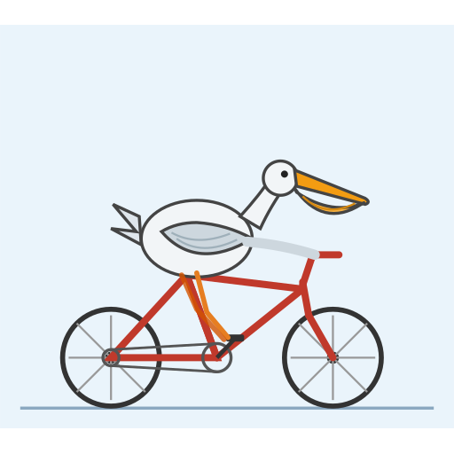

| Judge | Overall | P/B/R/C | Text reported | Original explanation |
|---|---:|---|---|---|
| astra | 7 | 2/2/1/2 | false | Readable pelican and complete bicycle with clean outlines; legs overlap at crank and reaching wing looks detached from its feather shape. |
| sol | 7 | 2/2/2/2 | false | Clear pouch, chain-driven bicycle and steering wing; narrow overlapping legs converge at crank but overall riding pose is readable. |
| luna | 8 | 2/2/2/2 | false | Long bill and pouch clearly define pelican; bicycle is complete and legs reach the drivetrain in a clean scene. |
| sonnet | 7 | 2/2/2/2 | false | Pelican with pouch seated on red bicycle, arm to bars, legs reaching pedals; clean, plain background, body slightly high. |
| haiku | 6 | 2/2/1/2 | false | Bill with lower pouch reads as pelican; clean bike; body sits on top tube, wing near bars, no saddle. |

## P121

**gyro-m-tq2_0-high-s22** · Human **7/10** · 256.8 s

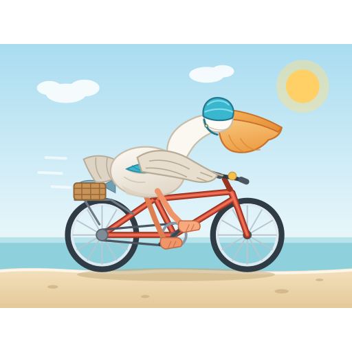

| Judge | Overall | P/B/R/C | Text reported | Original explanation |
|---|---:|---|---|---|
| astra | 8 | 2/2/2/2 | false | Attractive coastal cyclist with clear pouch, wing grip and pedaling feet; helmet obscures face and legs are somewhat crowded. |
| sol | 8 | 2/2/2/2 | false | Helmeted pelican with pronounced pouch and steering wing pedals detailed red bicycle; harmonious beach scene, though eyes are concealed. |
| luna | 8 | 2/2/2/2 | false | Pelican with prominent pouch rides a clearly framed bike; feet rest near pedals and the beach scene is attractive. |
| sonnet | 9 | 2/2/2/2 | false | Helmeted pelican with big pouch on red bike with rear basket, beach and sea, sun, speed lines; wing on bars, polished. |
| haiku | 8 | 2/2/2/2 | false | Pouch bill and helmet read as pelican; bike with basket is clear; body rests on frame, legs to pedals, wing reaches bars. |

## P125

**sc-exl3-2.05-h8-low-s33** · Human **2/10** · 53.5 s

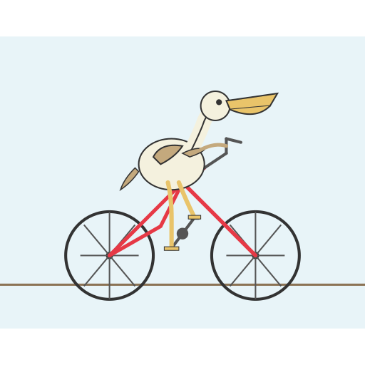

| Judge | Overall | P/B/R/C | Text reported | Original explanation |
|---|---:|---|---|---|
| astra | 4 | 1/1/1/1 | false | Generic narrow-billed bird above incomplete triangular frame; crank hangs detached and wheels sink below ground line. |
| sol | 4 | 2/1/1/1 | false | Pouch-billed bird is clear, but bicycle frame and crank are disconnected, handlebars float high and wheels sink through ground line. |
| luna | 7 | 2/2/1/2 | false | Pelican bill and pouch are clear; bicycle recognizable, but legs hang vertically rather than convincingly riding. |
| sonnet | 7 | 2/1/2/2 | false | Clear pelican riding; bicycle frame is distorted, missing seat and proper tubes, handlebar detached-looking. |
| haiku | 3 | 1/2/1/1 | false | Pointed bill with faint pouch; frame geometry is odd; body floats above the frame, legs pass through it, no seat contact. |

## P126

**gguf-iq3_s-medium-s22** · Human **5/10** · 54.1 s

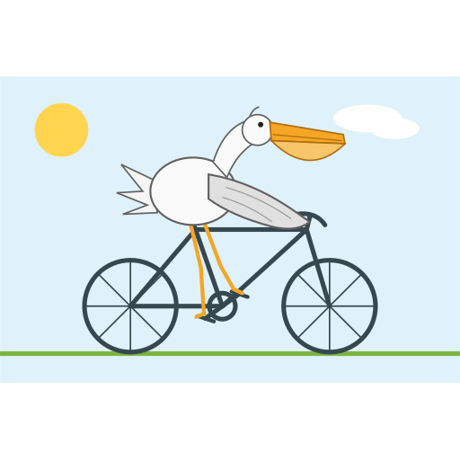

| Judge | Overall | P/B/R/C | Text reported | Original explanation |
|---|---:|---|---|---|
| astra | 8 | 2/2/2/2 | false | Clear pelican pouch, curved neck and feathered wing reaching bars; feet align with pedals in a tidy balanced scene. |
| sol | 7 | 2/2/2/2 | false | Clear pelican bill and curved neck, wing reaches bar and feet meet crank; straightforward well-arranged illustration with angular tail. |
| luna | 8 | 2/2/2/2 | false | Excellent pelican bill and pouch, complete bicycle, and legs clearly positioned on pedals; scene is clean. |
| sonnet | 8 | 2/2/2/2 | false | Clear pelican with pouch and curved neck on dark bicycle, wing on bars, legs on pedals, sun and cloud; clean. |
| haiku | 6 | 2/2/1/2 | false | Pouch bill reads as pelican; clean line-art bike; body rests on the top tube, legs to pedals, wing on bars, no saddle. |

## P143

**sc-exl3-2.05-h8-low-s55** · Human **4/10** · 57.4 s

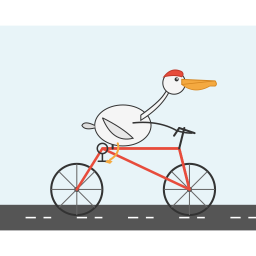

| Judge | Overall | P/B/R/C | Text reported | Original explanation |
|---|---:|---|---|---|
| astra | 4 | 1/1/1/1 | false | Bird has shallow ducklike bill; crank sits improbably at saddle and distorted frame lacks normal pedal geometry. |
| sol | 4 | 1/1/1/1 | false | Generic bird with short flattened beak perches on odd bicycle; crank sits at saddle height and tiny curled legs cannot pedal plausibly. |
| luna | 5 | 1/2/0/1 | false | Long beak but pouch is absent, so pelican identity is weak; bicycle is recognizable but bird floats above without riding contact. |
| sonnet | 6 | 2/2/1/1 | false | Pelican with cap and pouch above red bicycle, one short leg, pedals misplaced, arm toward bars; frame incomplete, body floats. |
| haiku | 3 | 1/2/1/1 | false | Bill has a weak pouch; bicycle is recognizable; body floats above the frame with no legs or seat contact. |

## P163

**gyro-m-tq2_0-medium-s22** · Human **5/10** · 57.4 s

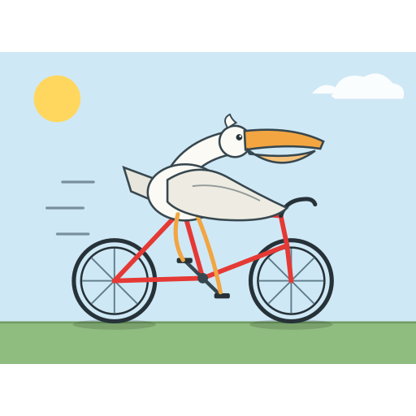

| Judge | Overall | P/B/R/C | Text reported | Original explanation |
|---|---:|---|---|---|
| astra | 8 | 2/2/2/2 | false | Distinct long beak and pouch, clean silhouette, wing reaches handlebars and both feet meet pedals. |
| sol | 8 | 2/2/2/2 | false | Elegant simple pelican cyclist with long pouch bill, forward wing on bars and bent legs on pedals; balanced clean scene. |
| luna | 8 | 2/2/2/2 | false | Long bill and pouch clearly mark pelican; complete bicycle and feet on crank in a simple balanced scene. |
| sonnet | 8 | 2/2/2/2 | false | Pelican with big beak and pouch crouched on red bicycle, wing to bars, legs on pedals, sun, speed lines, shadows; clean. |
| haiku | 6 | 2/2/1/2 | false | Bill with lower pouch reads as pelican; clean bike; body sits over the frame, legs to pedals, wing near bars, no saddle. |

## P164

**gyro-s-tq1_0-medium-s22** · Human **1/10** · 30.1 s

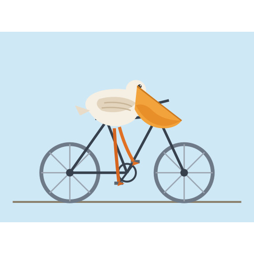

| Judge | Overall | P/B/R/C | Text reported | Original explanation |
|---|---:|---|---|---|
| astra | 5 | 2/2/1/1 | false | Oversized downward pouch obscures head and handlebars; folded wing and cramped body make riding unclear despite feet at crank ends. |
| sol | 5 | 2/2/1/1 | false | Huge downward bill overlaps steering and obscures face; bicycle is clear but bird appears perched with awkward neck and loosely aligned feet. |
| luna | 5 | 1/2/1/1 | false | Pelican shape is partly hidden by an oversized pouch; bicycle is recognizable, but feet barely connect to pedals. |
| sonnet | 6 | 2/2/1/1 | false | Pelican with huge pouch hiding the beak, perched over dark bicycle; legs reach pedals but no hands on bars, body floats, plain. |
| haiku | 4 | 2/2/1/1 | false | Bill dominates a tiny head, but reads as pelican; bike is clean; body hovers over frame, legs to pedals, no saddle. |

## P175

**gyro-s-tq1_0-high-s33** · Human **6/10** · 273.1 s

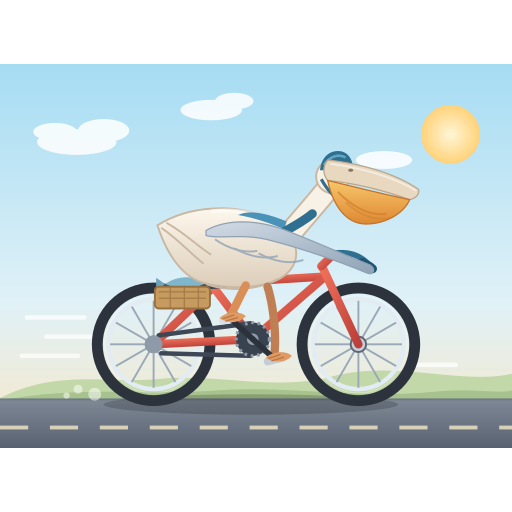

| Judge | Overall | P/B/R/C | Text reported | Original explanation |
|---|---:|---|---|---|
| astra | 7 | 2/2/1/2 | false | Detailed bicycle and large pouch, but tiny obscured head, detached-looking extended wing and dangling front foot weaken otherwise attractive scene. |
| sol | 8 | 2/2/2/2 | false | Detailed pelican with pouch and elongated steering wing rides clear bicycle; pleasant palette and motion, though tiny face and pedal geometry are weak. |
| luna | 9 | 2/2/2/2 | false | Prominent pelican pouch and bicycle with baskets; feet connect to pedals in a colorful, well-balanced scene. |
| sonnet | 8 | 2/2/2/2 | false | Pelican with pouch (beak oddly hooded), red bike with basket and chain, wing to bars, road, sun, speed lines; head slightly odd. |
| haiku | 6 | 2/2/1/2 | false | Pouch bill and cap read as pelican; bike with basket is clear; body floats above frame, legs reach pedals, wing rests on top tube. |

## P180

**td-exl3-2.68-h6-ng8-low-s22** · Human **3/10** · 137.1 s

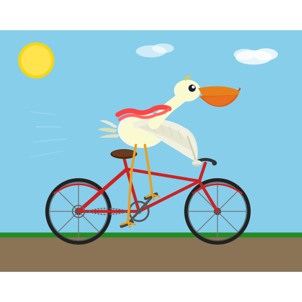

| Judge | Overall | P/B/R/C | Text reported | Original explanation |
|---|---:|---|---|---|
| astra | 6 | 1/2/1/2 | false | Cheerful scarfed bird and detailed bicycle, but short rounded bill and hovering body weaken pelican identity and seated contact. |
| sol | 6 | 2/2/1/2 | false | Clear pelican pouch and bicycle, wing reaches bars; body floats above saddle and thin feet miss convincing pedal placement. |
| luna | 8 | 2/2/1/2 | false | Clear pelican and detailed bicycle in a polished scene; long legs reach the pedals, though its pose is somewhat awkward. |
| sonnet | 9 | 2/2/2/2 | false | Vivid pelican with pouch and scarf, detailed red bicycle with seat and chain, wing on bars, legs on pedals, sun, motion. |
| haiku | 8 | 2/2/2/2 | false | Pouch bill reads as pelican; seated on saddle, legs to pedals, wing reaches bars; clean bike and sunny scene. |

## P190

**td-exl3-2.68-h6-ng8-high-s55** · Human **8/10** · 829.9 s

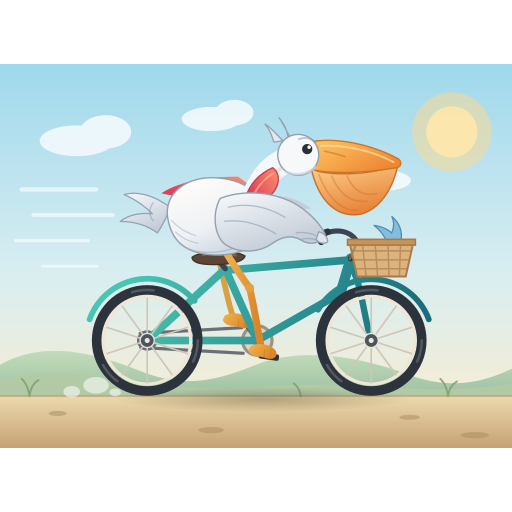

| Judge | Overall | P/B/R/C | Text reported | Original explanation |
|---|---:|---|---|---|
| astra | 10 | 2/2/2/2 | false | Distinctive large pouch, convincing seated pedaling and handlebar contact, detailed bicycle and balanced polished landscape. |
| sol | 9 | 2/2/2/2 | false | Well-integrated pelican with deep pouch, steering wing and bent pedaling legs; detailed bicycle and basket create polished coherent scene. |
| luna | 9 | 2/2/2/2 | false | Large pouch and bill clearly identify pelican; complete bicycle, feet on pedals, basket and scenic setting. |
| sonnet | 10 | 2/2/2/2 | false | Excellent: pelican with big pouch, teal bike with basket, fish, fenders, seat, trail, hills, sun, speed lines; convincing ride. |
| haiku | 9 | 2/2/2/2 | false | Clear pelican with large pouch seated on saddle, legs on pedals, wing on bars; full bicycle with basket; clean scene. |

## P193

**gyro-m-tq2_0-high-s55** · Human **10/10** · 129.7 s

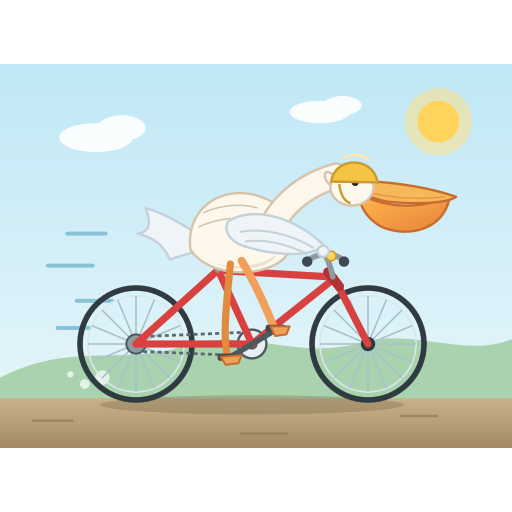

| Judge | Overall | P/B/R/C | Text reported | Original explanation |
|---|---:|---|---|---|
| astra | 9 | 2/2/2/2 | false | Clear pelican pouch and arched neck, good grip and opposite pedal contacts; detailed bicycle and soft landscape compose an appealing scene. |
| sol | 8 | 2/2/2/2 | false | Clear helmeted pelican with large pouch and steering wing, feet on pedals and coherent bicycle; pleasant simple pastoral composition. |
| luna | 9 | 2/2/2/2 | false | Clear pelican pouch and bill, detailed bicycle, and feet on pedals in a nicely layered landscape. |
| sonnet | 10 | 2/2/2/2 | false | Excellent: helmeted pelican with large pouch, detailed red bicycle with chain, hills, dust, sun, motion lines, convincing ride. |
| haiku | 8 | 2/2/2/2 | false | Big pouch bill reads as pelican; bike is clear; seated over frame, legs reach pedals, wing reaches bars; clean scene. |

## P195

**gguf-iq3_xxs-medium-s11** · Human **3/10** · 30.4 s

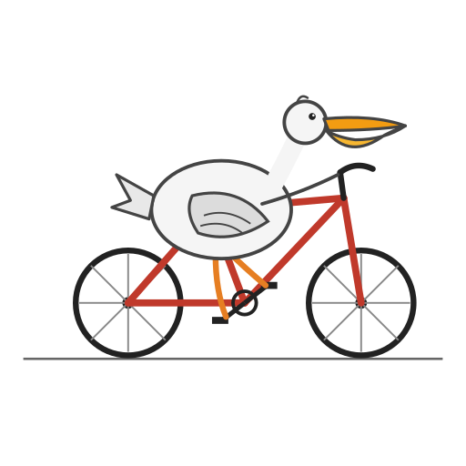

| Judge | Overall | P/B/R/C | Text reported | Original explanation |
|---|---:|---|---|---|
| astra | 7 | 2/2/2/2 | false | Simple pelican with pouch and clear pedal contact; thin line reaching bars is anatomically weak but scene remains readable and clean. |
| sol | 7 | 2/2/2/2 | false | Clean recognizable pelican and bicycle with feet on pedals; oversized body and thin extended steering limb feel schematic. |
| luna | 7 | 2/2/1/2 | false | Clear pelican features and bicycle, but legs are short and do not establish a convincing riding posture. |
| sonnet | 6 | 2/2/1/1 | false | Pelican with pouch and clear bicycle, but body is big and sunk into frame, neck faint and detached, legs stubby. |
| haiku | 6 | 2/2/1/2 | false | Bill with lower pouch reads as pelican; clean bike; body sits over frame, legs reach pedals, wing reaches bars, no seat contact. |

## P200

**td-exl3-2.18-h6-ng8-medium-s22** · Human **3/10** · 135.8 s

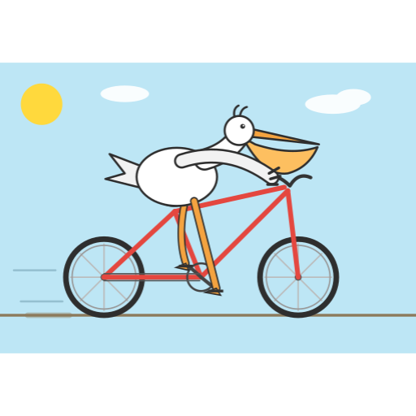

| Judge | Overall | P/B/R/C | Text reported | Original explanation |
|---|---:|---|---|---|
| astra | 8 | 2/2/2/2 | false | Expressive pelican with pronounced pouch, wing gripping bars and feet on pedals; simple bicycle and dynamic forward posture communicate riding well. |
| sol | 7 | 2/2/2/2 | false | Clear pelican pouch, extended steering wing and feet at crank; clean bicycle scene with slightly cluttered hand and pedal details. |
| luna | 8 | 2/2/2/2 | false | Distinct pelican pouch and bill, clear bicycle, and feet reach pedals in a clean side-view composition. |
| sonnet | 8 | 2/2/2/2 | false | Pelican with pouch leaning to bars, long legs on pedals, red bicycle, sun, clouds, speed lines; clean, body floats a little above seat. |
| haiku | 6 | 2/2/1/2 | false | Clear pelican with pouch bill; bicycle complete; no saddle, body sits on the top tube, wing reaches bars. |

## P201

**gguf-iq3_xxs-high-s22** · Human **6/10** · 267.4 s

| Judge | Overall | P/B/R/C | Text reported | Original explanation |
|---|---:|---|---|---|
| astra | 8 | 2/2/2/2 | false | Detailed pelican and bicycle with good bar contact, but one foot appears detached and pouch has an unusual bucketlike shape. |
| sol | 6 | 2/2/1/1 | false | Detailed helmeted pelican and bicycle, but an extra dangling leg and detached-looking foot confuse pedaling; oversized fish pouch crowds steering. |
| luna | 9 | 2/2/2/2 | false | Pelican pouch and bicycle are clear, legs on pedals, and fish-filled pouch plus helmet add coherent detail. |
| sonnet | 10 | 2/2/2/2 | false | Excellent: helmeted pelican with fish in pouch, leaning on bars, detailed bike, speed lines, sun; expressive and cohesive. |
| haiku | 7 | 2/2/1/2 | false | Pouch bill with fish and helmet read as pelican; detailed bike; body sits over top tube with no clear saddle, wing reaches bars. |

## P204

**sc-exl3-2.05-h8-medium-s44** · Human **1/10** · 55.4 s

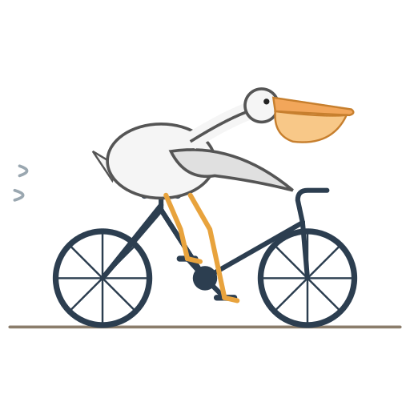

| Judge | Overall | P/B/R/C | Text reported | Original explanation |
|---|---:|---|---|---|
| astra | 5 | 2/1/1/1 | true | Clear pouch and large bird, but wing stops short of bars and incomplete bicycle frame leaves rear wheel poorly connected. |
| sol | 6 | 2/2/1/2 | false | Large pouch makes pelican identifiable; feet reach pedals but wing misses handlebar and sparse neck outline feels unfinished. |
| luna | 8 | 2/2/2/2 | false | Prominent throat pouch and long beak, full bicycle, and legs on crank in a crisp minimal scene. |
| sonnet | 8 | 2/2/2/2 | false | Clean pelican with pouch, legs on pedals, wing toward bars, speed marks; slightly floaty body above seat. |
| haiku | 7 | 2/2/1/2 | false | Clean line-art pelican with pouch bill; bicycle clear; body sits over frame with no saddle, legs reach pedals. |

## P205

**gyro-m-tq2_0-low-s22** · Human **1/10** · 35.8 s

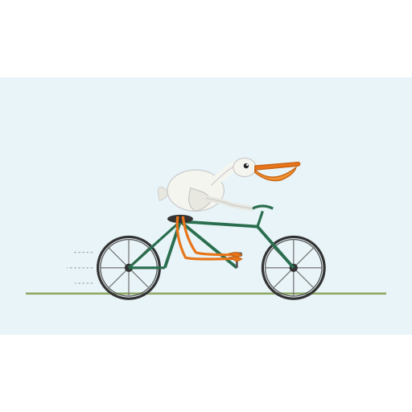

| Judge | Overall | P/B/R/C | Text reported | Original explanation |
|---|---:|---|---|---|
| astra | 4 | 2/1/1/1 | false | Small pelican has recognizable pouch, but body hovers over saddle and both legs stretch forward across an incomplete bicycle frame. |
| sol | 6 | 2/2/1/2 | false | Recognizable small pelican and bicycle with tidy spacing; legs extend together horizontally rather than convincing pedal contact. |
| luna | 5 | 1/2/1/1 | false | Long bill and faint pouch weakly suggest pelican; bicycle is clear but legs extend sideways with little riding contact. |
| sonnet | 5 | 2/2/1/1 | false | Small faint pelican with pouch floating above green bicycle; body low-contrast, legs bent into odd loop, frame and pedals broken. |
| haiku | 6 | 2/2/2/1 | false | Clear pouch bill; bicycle frame and wheels fine; seated on saddle with legs to pedals; figure is small and sparse in the frame. |

## P215

**sc-exl3-3.05-h8-low-s44** · Human **5/10** · 76.2 s

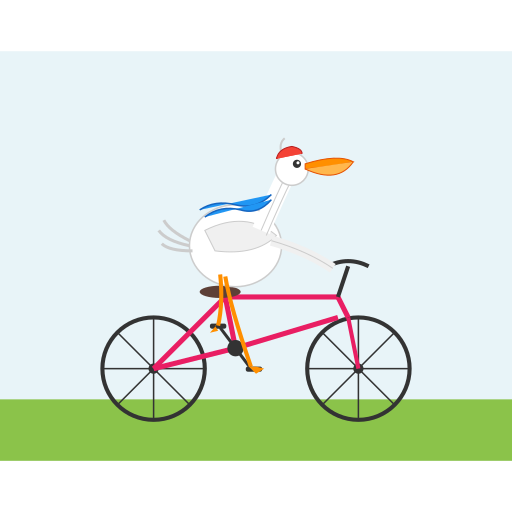

| Judge | Overall | P/B/R/C | Text reported | Original explanation |
|---|---:|---|---|---|
| astra | 6 | 1/2/2/2 | false | Clean seated cyclist with scarf and pedal contact, but tiny oval beak lacks distinctive pelican length and throat pouch. |
| sol | 6 | 1/2/1/2 | false | Clean bicycle and scarf-wearing bird, but short beak lacks distinctive pouch; wing stops just short of handlebar and feet loosely meet crank. |
| luna | 7 | 1/2/2/2 | false | Long bill and slight pouch suggest pelican, bicycle is complete, and feet meet crank in a neat scene. |
| sonnet | 7 | 1/2/2/2 | false | Clean bicycle and seated bird with cap and scarf; beak small, no real pouch, so more generic bird than pelican. |
| haiku | 5 | 1/2/2/2 | false | Short pointed bill with no pouch, so only bird-like; bike clear; seated on saddle, legs reach pedals, wing reaches bars. |

## P224

**sc-exl3-2.05-h8-low-s11** · Human **1/10** · 66.6 s

| Judge | Overall | P/B/R/C | Text reported | Original explanation |
|---|---:|---|---|---|
| astra | 3 | 1/1/1/1 | false | Circular bird with hollow neck and small bill hovers over skeletal malformed bicycle; bent feet lack clear pedal connections. |
| sol | 4 | 1/1/1/1 | false | Round bird with short pouch-like bill and open neck outlines; bicycle crank misplaced near rear wheel and incomplete frame weaken riding. |
| luna | 4 | 1/1/1/1 | false | Long-billed bird but pouch is subtle; bicycle frame lacks clear conventional structure, and limbs do not show a convincing ride. |
| sonnet | 5 | 2/1/1/1 | false | Pelican with pouch and arm to bars, but bicycle frame is broken and tangled, legs tiny, body floating well above seat. |
| haiku | 4 | 1/2/1/2 | false | Flat short bill, little pouch, so weakly pelican; bicycle frame is odd but readable; body sits awkwardly over frame, wing reaches bars. |

## P230

**gguf-iq3_xxs-medium-s22** · Human **2/10** · 31.3 s

| Judge | Overall | P/B/R/C | Text reported | Original explanation |
|---|---:|---|---|---|
| astra | 6 | 2/2/1/2 | false | Bold readable pelican and bicycle with feet near pedals; folded wing never engages handlebars, giving a static perched impression. |
| sol | 6 | 2/2/1/2 | false | Readable pouch-billed bird and black bicycle with feet near pedals; folded wing and upright posture offer no steering contact. |
| luna | 8 | 2/2/2/2 | false | Distinct bill and pouch, full bicycle, and visible feet at crank; clean, straightforward composition. |
| sonnet | 7 | 2/2/1/2 | false | Pelican with pouch on dark bicycle, legs on pedals, speed lines, sun; body covers frame, no hand on bars, short neck. |
| haiku | 6 | 2/2/1/2 | false | Bill with lower pouch reads as pelican; clean bike; body sits above frame, legs reach pedals, no arms or seat contact. |

## P233

**sc-exl3-2.05-h8-medium-s22** · Human **4/10** · 83.5 s

| Judge | Overall | P/B/R/C | Text reported | Original explanation |
|---|---:|---|---|---|
| astra | 7 | 2/2/2/2 | false | Simple gray pelican with clear orange pouch; bent legs meet pedals and extended wing touches bars on a coherent bicycle. |
| sol | 8 | 2/2/2/2 | false | Readable large pouch, balanced frame and convincing bent legs on opposite pedals; restrained clean illustration. |
| luna | 7 | 2/2/1/2 | false | Bill and pouch make the pelican clear, and bike frame is complete; angular dangling legs make riding slightly awkward. |
| sonnet | 7 | 2/2/2/2 | false | Gray pelican with pouch on blue bicycle, wing to bars, legs on pedals; clean, simple, short neck, plain background. |
| haiku | 6 | 2/2/1/2 | false | Pouch bill reads as pelican; clean bike; body sits above the top tube, legs reach pedals, wing reaches bars; seat contact is unclear. |

## P250

**sc-exl3-2.05-h8-high-s22** · Human **8/10** · 1013.5 s

| Judge | Overall | P/B/R/C | Text reported | Original explanation |
|---|---:|---|---|---|
| astra | 8 | 2/2/1/2 | false | Elaborate pelican with translucent pouch and strong handlebar grip; dynamic scene, but splayed foot extends beyond pedal and details crowd the bike. |
| sol | 9 | 2/2/2/2 | false | Detailed dynamic pelican with translucent fish-filled pouch, helmet and steering contact; layered bicycle scene has strong personality despite tangled feet. |
| luna | 9 | 2/2/2/2 | false | Very clear large pelican pouch, cyclist helmet, detailed bicycle and legs at pedals; composition is richly polished. |
| sonnet | 9 | 2/2/2/2 | false | Detailed pelican with helmet, scarf and pouch with fish, blue bike, road, trees, sun, motion lines; wing and legs slightly tangled but vivid. |
| haiku | 9 | 2/2/2/2 | false | Clear pelican with pouch holding a fish and helmet; seated on bike, legs to pedals, hands on bars; detailed road scene. |

## P255

**gyro-s-tq1_0-low-s33** · Human **4/10** · 31.2 s

| Judge | Overall | P/B/R/C | Text reported | Original explanation |
|---|---:|---|---|---|
| astra | 8 | 2/2/2/2 | false | Clear pouch and bicycle, wing reaches handlebars; feet sit near pedals in a clean cheerful scene. |
| sol | 5 | 2/2/1/1 | false | Long open bill and red pouch suggest pelican, but legs detach from hovering body; crooked front frame and saddle gap undermine riding. |
| luna | 8 | 2/2/2/2 | false | Long bill and visible pouch identify pelican; complete bicycle and feet connect to pedals in a clean roadway scene. |
| sonnet | 5 | 1/2/1/1 | false | Round bird with long beak and red open mouth, arm on bars; body floats above seat, legs dangle. Bike clear; pelican only loosely. |
| haiku | 4 | 1/2/1/1 | false | Pointed beak with red inner, no clear pouch; bike is clear; legs are loose lines, arm reaches bars, body floats over frame. |

## P282

**gguf-iq3_xxs-high-s44** · Human **4/10** · 238.3 s

| Judge | Overall | P/B/R/C | Text reported | Original explanation |
|---|---:|---|---|---|
| astra | 6 | 2/2/1/1 | false | Large pouch identifies pelican, but compressed head-wing overlap and elongated malformed front frame make an awkward riding composition. |
| sol | 7 | 2/2/2/2 | false | Large pouch and low riding posture are clear; feet touch crank and wing reaches bars, though oversized fork and bill feel unbalanced. |
| luna | 7 | 2/2/2/1 | false | Pelican and bicycle are clear with feet at pedals, though the frame geometry is odd and scene is plain. |
| sonnet | 8 | 2/2/2/2 | false | Tucked pelican with big pouch, red bicycle, legs on pedals, shadow; no neck visible but charming and clean. |
| haiku | 5 | 2/2/1/1 | false | Pouch bill reads as pelican; frame has odd geometry; body and head overlap the frame, legs reach pedals, no bar contact. |

## P290

**sc-exl3-2.05-h8-high-s33** · Human **8/10** · 1187.6 s

| Judge | Overall | P/B/R/C | Text reported | Original explanation |
|---|---:|---|---|---|
| astra | 8 | 2/2/1/2 | false | Rich night scene and emphatic pelican pouch; detailed bike, though pale straight legs and long handlike wing weaken natural pedaling. |
| sol | 8 | 2/2/2/2 | false | Stylish dark scenic palette and obvious pelican pouch; seated rider reaches bars and crank, though pale stick legs and hidden eye reduce expression. |
| luna | 9 | 2/2/2/2 | false | Prominent pelican pouch and bill, detailed bicycle, feet on pedals, and striking night-road composition. |
| sonnet | 10 | 2/2/2/2 | false | Excellent: helmeted scarfed pelican with big pouch, bike with basket and chain, coastal road, palms, sun, gulls; arm on bars, riding. |
| haiku | 9 | 2/2/2/2 | false | Large pouch, cap and scarf make a clear pelican; seated on saddle, legs to pedals, arm on bars; well-arranged harbour scene. |

## P298

**gguf-iq3_s-high-s11** · Human **8/10** · 419.4 s

| Judge | Overall | P/B/R/C | Text reported | Original explanation |
|---|---:|---|---|---|
| astra | 9 | 2/2/2/2 | false | Expressive pelican leans over handlebars with articulated pedaling legs; warm layered feather shapes and clean bicycle create a convincing scene. |
| sol | 9 | 2/2/2/2 | false | Expressive streamlined pelican, distinctive pouch, natural bent pedaling legs and wing on bars; polished cheerful countryside scene. |
| luna | 9 | 2/2/2/2 | false | Expressive pelican with bill and pouch rides a clear bicycle; legs extend to pedals in a complete road scene. |
| sonnet | 9 | 2/2/2/2 | false | Polished: pelican with large pouch, scarf, orange bike with chain, road, hills, sun, speed lines; neck tucked and wing a bit odd. |
| haiku | 8 | 2/2/2/2 | false | Big pouch bill and wing on bars make a clear pelican; seated on saddle, legs to pedals; road scene is clean. |

## P302

**gyro-m-tq2_0-medium-s33** · Human **1/10** · 31.6 s

| Judge | Overall | P/B/R/C | Text reported | Original explanation |
|---|---:|---|---|---|
| astra | 5 | 1/2/1/2 | false | Readable bird on bicycle with pedal contact, but shallow beak pouch, disconnected neck contour and no handlebar reach reduce specificity. |
| sol | 5 | 2/2/1/1 | false | Large pouch-billed bird obscures bicycle, head-neck join is broken and no wing reaches bars; feet at least meet pedals. |
| luna | 8 | 2/2/2/2 | false | Pouch and bill clearly identify pelican; complete bicycle and feet at crank make the riding pose readable. |
| sonnet | 6 | 2/2/1/1 | false | Pelican with beak and slight pouch, but huge body hides frame, no neck, legs stubby; bicycle clear. |
| haiku | 5 | 2/2/1/2 | false | Bill with a pouch curve reads as pelican; bike clean; body sits on top of frame with legs to pedals, no arms to bars. |

## P303

**gguf-iq3_s-low-s11** · Human **3/10** · 37.4 s

| Judge | Overall | P/B/R/C | Text reported | Original explanation |
|---|---:|---|---|---|
| astra | 5 | 1/2/1/2 | false | Round bird with stacked oval bill looks ducklike; wing stops short of bars and parallel legs crowd the central crank. |
| sol | 8 | 2/2/2/2 | false | Clean friendly pelican with open pouch, seated over saddle and feet on crank; wing nearly reaches handlebar. |
| luna | 7 | 2/2/1/2 | false | Pelican and bicycle are clear; bird is perched over the rear frame, with legs reaching pedals but awkwardly positioned. |
| sonnet | 7 | 2/2/2/2 | false | Cute pelican with cap and small pouch seated on red bicycle, legs on pedals, wing to bars; neck missing, simple. |
| haiku | 5 | 1/2/2/2 | false | Bill is flat with no clear throat pouch, so weakly pelican; bike clean; seated on saddle, legs reach pedals, arm reaches forward. |

## P312

**gguf-iq3_s-high-s55** · Human **7/10** · 454.6 s

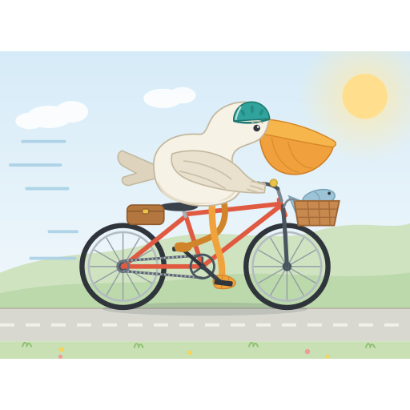

| Judge | Overall | P/B/R/C | Text reported | Original explanation |
|---|---:|---|---|---|
| astra | 9 | 2/2/2/2 | false | Well-defined pelican pouch and feathered wing, convincing seated pedaling, detailed bicycle and charming fish basket in balanced landscape. |
| sol | 9 | 2/2/2/2 | false | Appealing helmeted pelican with large pouch, steering wing and bent pedal contact; detailed bicycle, fish basket and countryside are cohesive. |
| luna | 9 | 2/2/2/2 | false | Clearly recognizable pelican and detailed bicycle, with feet on pedals, helmet and baskets in a polished road scene. |
| sonnet | 10 | 2/2/2/2 | false | Excellent: helmeted pelican with big pouch, bike with basket and fish, saddlebag, chain, road, hills, sun; seated riding. |
| haiku | 8 | 2/2/2/2 | false | Pouch bill and helmet read as pelican; seated on saddle, legs to pedals, wing on bars; basket and road scene are clean. |

## P341

**gyro-s-tq1_0-low-s55** · Human **5/10** · 33.6 s

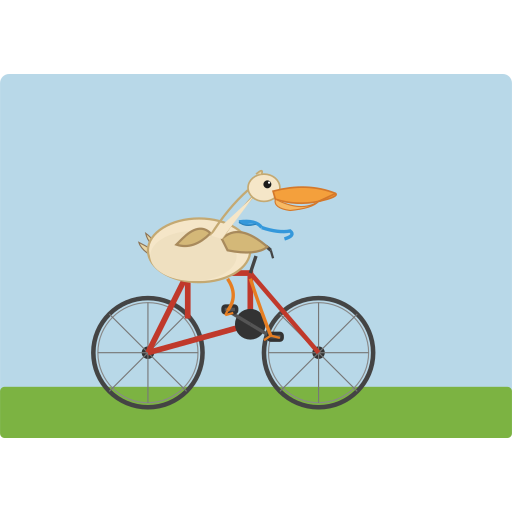

| Judge | Overall | P/B/R/C | Text reported | Original explanation |
|---|---:|---|---|---|
| astra | 5 | 1/2/1/2 | false | Small shallow bill and narrow neck suggest generic bird; short folded wing and crowded frame make riding awkward despite pedal contact. |
| sol | 5 | 1/2/1/1 | false | Short shallow bill and open narrow neck suggest generic bird; feet touch crank, but wing and handlebar shapes merge awkwardly with scarf. |
| luna | 6 | 2/2/1/1 | false | Pelican pouch and bicycle are identifiable, but limbs are obscured and riding contact is unclear. |
| sonnet | 7 | 2/2/2/2 | false | Cream pelican with pouch, scarf, seated on red bicycle with legs on pedals; legs short, simple but tidy. |
| haiku | 4 | 1/2/1/1 | false | Bill is a plain beak with a faint pouch, weakly pelican; bike is simple; body sits on frame, legs faint, no clear grip on bars. |

## P344

**td-exl3-2.68-h6-ng8-low-s55** · Human **1/10** · 94.1 s

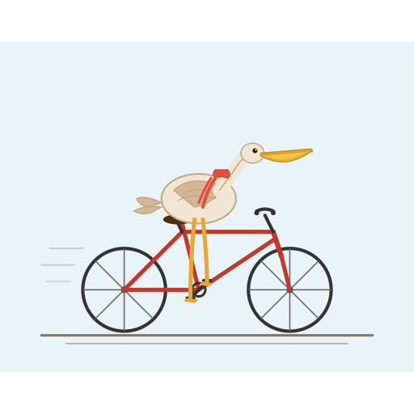

| Judge | Overall | P/B/R/C | Text reported | Original explanation |
|---|---:|---|---|---|
| astra | 5 | 1/2/1/2 | false | Small bird with very shallow bill pouch sits on bicycle, but folded wing and clustered straight legs suggest perching more than riding. |
| sol | 6 | 2/2/1/2 | false | Neat long-billed pelican perched on red bicycle; parallel legs reach crank but neither wing engages the handlebar. |
| luna | 7 | 2/2/1/2 | false | Pelican bill and pouch are identifiable and bicycle complete; legs extend awkwardly straight down near crank. |
| sonnet | 6 | 2/2/1/2 | false | Pelican with long beak and shallow pouch seated on red bicycle, legs straight to pedals; no hand on bars, thin and simple. |
| haiku | 4 | 1/2/1/1 | false | Long thin beak but no throat pouch; bike is complete; body floats above frame with legs stuck through it. |

## P348

**td-exl3-2.18-h6-ng8-medium-s33** · Human **6/10** · 121.8 s

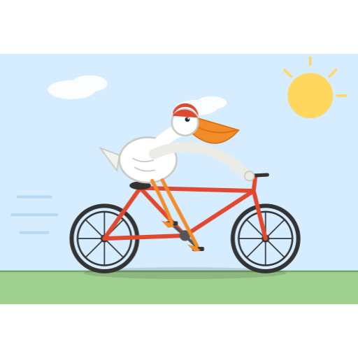

| Judge | Overall | P/B/R/C | Text reported | Original explanation |
|---|---:|---|---|---|
| astra | 8 | 2/2/2/2 | false | Clean bright cyclist with clear pouch, seated posture, wing on bars and feet on opposing pedals. |
| sol | 7 | 2/2/2/2 | false | Helmeted pouch-billed bird sits on saddle and reaches pedals and bar; very long narrow wing feels artificial but scene reads well. |
| luna | 8 | 2/2/2/2 | false | Pelican profile and pouch are evident; bicycle is clear, with bird seated and feet touching pedals in a bright scene. |
| sonnet | 9 | 2/2/2/2 | false | Cheerful striped-cap pelican with pouch, long arm to bars, legs on pedals, red bicycle, shadow, sun, speed lines; clean and cohesive. |
| haiku | 7 | 1/2/2/2 | false | Wedge bill has no clear pouch, so pelican is weak; bike clean; seated on saddle, legs to pedals, wing on bars; tidy scene. |

## P349

**sc-exl3-3.05-h8-high-s44** · Human **9/10** · 359.4 s

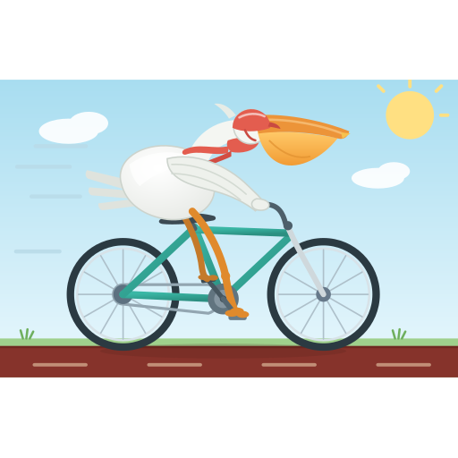

| Judge | Overall | P/B/R/C | Text reported | Original explanation |
|---|---:|---|---|---|
| astra | 9 | 2/2/2/2 | false | Strong pouch silhouette and flowing cyclist posture, detailed bicycle and clear pedal contacts; helmet obscures face but composition remains polished. |
| sol | 8 | 2/2/2/2 | false | Flowing pelican silhouette with prominent pouch, steering wing and pedaling contact; pleasing bicycle scene, though helmet hides face. |
| luna | 9 | 2/2/2/2 | false | Bright pelican with prominent pouch and a full bicycle; feet clearly engage pedals, with lively road setting. |
| sonnet | 9 | 2/2/2/2 | false | Helmeted scarfed pelican with pouch crouched on teal bicycle, legs on pedals, wing to bars, sun, track, speed lines; polished. |
| haiku | 8 | 2/2/2/2 | false | Pouch bill and red helmet read as pelican; bike is detailed; seated on saddle, legs to pedals, wing on bars. |

## P360

**gyro-s-tq1_0-low-s22** · Human **6/10** · 41.7 s

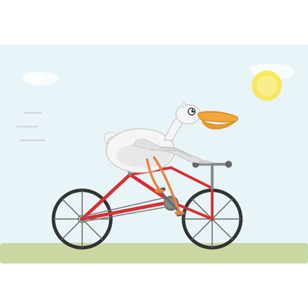

| Judge | Overall | P/B/R/C | Text reported | Original explanation |
|---|---:|---|---|---|
| astra | 6 | 1/2/2/2 | false | Pedal and handlebar contacts are evident, but short oval bill and round body resemble a generic bird more than pelican. |
| sol | 6 | 2/2/2/1 | false | Pouch-billed bird reaches handlebars and pedals, but bicycle frame connects awkwardly at front hub and pale body shapes overlap confusingly. |
| luna | 6 | 2/2/1/1 | false | Pelican and bicycle are identifiable with feet near the pedals, though overlapping frame geometry makes the ride awkward. |
| sonnet | 8 | 2/2/2/2 | false | Pelican with pouch on red bicycle, scene with sun and grass; frame slightly odd, bird floats over frame. |
| haiku | 6 | 2/2/1/2 | false | Long pouch bill reads as pelican; bike is clear; body floats over top tube, legs reach pedals, no seat contact. |

## P366

**sc-exl3-3.05-h8-low-s55** · Human **5/10** · 80.6 s

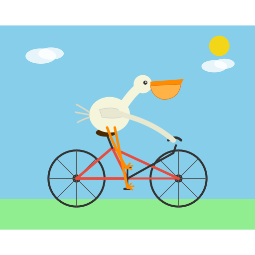

| Judge | Overall | P/B/R/C | Text reported | Original explanation |
|---|---:|---|---|---|
| astra | 7 | 2/2/2/2 | false | Recognizable pouch and clean bicycle; seated bird reaches bars, though elongated limbs and simplified anatomy look stiff. |
| sol | 4 | 2/1/1/1 | false | Pouch-billed bird recognizable, but frame lacks a clear crank and connected steering; stretched wing and splayed feet make riding unconvincing. |
| luna | 6 | 2/2/1/1 | false | Pelican and bicycle are clear; feet cluster awkwardly at the frame and contact does not convincingly show pedaling. |
| sonnet | 7 | 2/2/2/2 | false | Pelican with round pouch, seated on red bicycle, long arm to bars, legs on pedals, sun, clouds; frame slightly odd, simple. |
| haiku | 5 | 1/2/2/1 | false | Bill is flat and wedge-like with no clear pouch, so weakly pelican; seated on saddle, legs to pedals, arm reaches bars; frame is odd. |

## P370

**td-exl3-2.18-h6-ng8-high-s55** · Human **8/10** · 782.0 s

| Judge | Overall | P/B/R/C | Text reported | Original explanation |
|---|---:|---|---|---|
| astra | 8 | 2/2/2/2 | false | Polished scenic cyclist with feather details, pouch and handgrip; bill is short and one straight dominant leg limits naturalness. |
| sol | 8 | 2/2/2/2 | false | Layered scenic illustration with helmeted pouch-billed bird, steering wing and pedal contact; small scale and heavy shading obscure some anatomy. |
| luna | 9 | 2/2/2/2 | false | Expressive pelican with throat pouch rides a complete detailed bicycle; feet meet pedals amid polished scenery. |
| sonnet | 10 | 2/2/2/2 | false | Polished illustration: helmeted scarfed pelican with pouch, detailed bike with pannier and chain, road, sun, birds, motion lines. |
| haiku | 8 | 2/2/2/2 | false | Pouch bill, cap and scarf make a clear pelican; fenders and pannier add detail; body rests on frame, legs to pedal, wing on bars. |

## P376

**gyro-s-tq1_0-high-s11** · Human **8/10** · 149.9 s

| Judge | Overall | P/B/R/C | Text reported | Original explanation |
|---|---:|---|---|---|
| astra | 7 | 2/2/1/2 | false | Appealing long-billed pelican and detailed bike, but extended lower leg reaches a pedal far from the crank and neck is barely connected. |
| sol | 7 | 2/2/1/2 | false | Appealing pelican with long layered pouch and steering wing; detailed bicycle and fish basket, but extended front foot misses pedal convincingly. |
| luna | 8 | 2/2/2/2 | false | Pelican pouch and bill are clear, with detailed bicycle, feet on pedals, and pleasant road-side composition. |
| sonnet | 9 | 2/2/2/2 | false | Helmeted scarfed pelican with pouch, red bike with fish basket, chain, wing to bars, legs on pedals, sun, dust, speed lines. |
| haiku | 7 | 2/2/2/2 | false | Pouch bill reads as pelican; seated on saddle, legs to pedals, arm reaches bars; clean scene, though the red wing looks odd. |

## P383

**gguf-iq3_s-low-s55** · Human **1/10** · 33.0 s

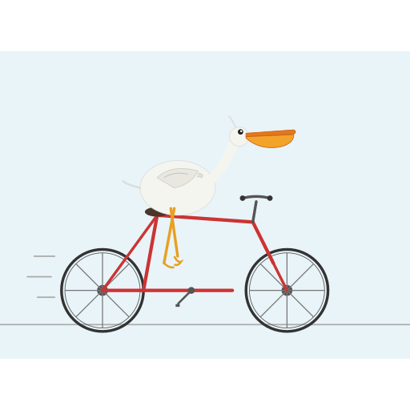

| Judge | Overall | P/B/R/C | Text reported | Original explanation |
|---|---:|---|---|---|
| astra | 4 | 2/1/1/1 | false | Recognizable small pelican sits on saddle, but legs dangle above crank, wing stays folded and incomplete frame ends in midair. |
| sol | 5 | 2/2/1/1 | false | Bird has clear pouch but feet dangle above crank; incomplete lower frame and absent steering contact undermine bicycle riding. |
| luna | 6 | 2/2/1/1 | false | Long bill and pouch suggest a pelican and bicycle is recognizable, but the sparse frame and dangling feet make riding unclear. |
| sonnet | 6 | 2/2/1/1 | false | Pelican with pouch and long neck above seat, but feet dangle off pedals, no hand on bars, frame bottom bracket broken. |
| haiku | 3 | 2/1/0/1 | false | Pouch bill reads as pelican; bike is broken, with a disconnected pedal and crank; body is perched on the frame with no real riding contact. |

## P386

**gguf-iq3_xxs-medium-s44** · Human **3/10** · 45.6 s

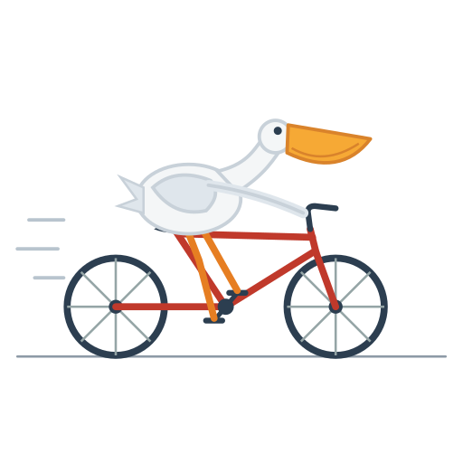

| Judge | Overall | P/B/R/C | Text reported | Original explanation |
|---|---:|---|---|---|
| astra | 8 | 2/2/2/2 | false | Minimal but coherent pelican, obvious pouch, handlebar contact and separated pedal positions; balanced crisp linework. |
| sol | 7 | 2/2/2/2 | false | Recognizable pouch-billed pelican with long steering wing and pedal contacts on clean bicycle; pale outlines and elongated limb reduce finish. |
| luna | 8 | 2/2/2/2 | false | Pouch and long beak clearly mark pelican; bicycle is complete and feet sit at the pedals. |
| sonnet | 8 | 2/2/2/2 | false | Clean pelican with big pouch and curved neck, red bicycle, wing to bars, legs on pedals, speed lines; flat and tidy. |
| haiku | 6 | 2/2/1/2 | false | Pouch-like bill reads as pelican; bike clean; body sits above frame, legs reach pedals, wing reaches bars, no seat contact. |

## P392

**sc-exl3-2.05-h8-high-s11** · Human **8/10** · 643.1 s

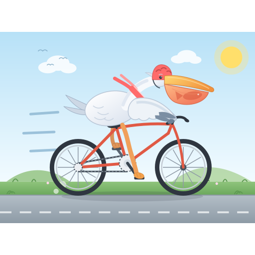

| Judge | Overall | P/B/R/C | Text reported | Original explanation |
|---|---:|---|---|---|
| astra | 9 | 2/2/2/2 | false | Polished expressive pelican with fish-filled pouch, feathered grip and pedaling stance; detailed bicycle and cohesive colorful road scene. |
| sol | 9 | 2/2/2/2 | false | Expressive helmeted pelican with fish in pouch, clear steering and pedal contact; polished motion scene and detailed bicycle. |
| luna | 9 | 2/2/2/2 | false | Expressive pelican with prominent pouch rides a full bicycle; feet contact pedals amid polished roadside scenery. |
| sonnet | 10 | 2/2/2/2 | false | Excellent: helmeted scarfed pelican with fish in pouch, detailed bike with chain, wing on bars, road, sun, birds, motion lines. |
| haiku | 8 | 2/2/2/2 | false | Big pouch bill reads as pelican; seated on saddle, legs to pedals, wing on bars; bike and road scene are clean. |

## P394

**sc-exl3-2.05-h8-high-s44** · Human **6/10** · 506.8 s

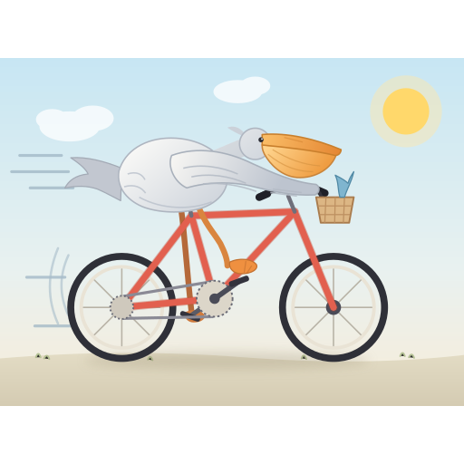

| Judge | Overall | P/B/R/C | Text reported | Original explanation |
|---|---:|---|---|---|
| astra | 7 | 2/2/1/2 | false | Detailed gray pelican and bicycle, but elevated foot misses pedal and long horizontal wing gives a flattened, awkward pose. |
| sol | 9 | 2/2/2/2 | false | Expressive forward riding posture, prominent pouch, clear pedal contact and detailed chain; attractive cohesive outdoor scene. |
| luna | 9 | 2/2/2/2 | false | Recognizable pelican with pouch rides a full bicycle; feet connect to the crank and basket enriches a balanced scene. |
| sonnet | 9 | 2/2/2/2 | false | Shaded pelican with pouch, bike with basket and fish, chain, sun, speed lines; neck hidden but convincing riding pose. |
| haiku | 7 | 2/2/1/2 | false | Pouch bill reads as pelican; bike with basket is clear; body floats above top tube, wing reaches bars, one leg to pedal. |

## P398

**gyro-s-tq1_0-medium-s11** · Human **4/10** · 25.8 s

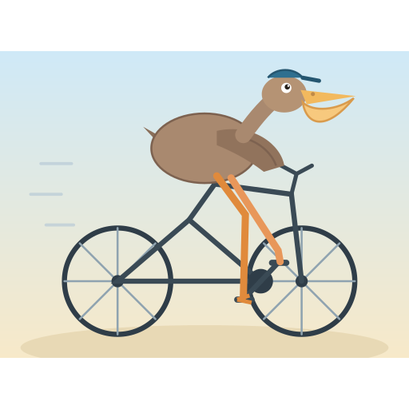

| Judge | Overall | P/B/R/C | Text reported | Original explanation |
|---|---:|---|---|---|
| astra | 7 | 2/2/2/2 | false | Brown pelican with clear pouch and articulated pedal stance; wing reaches bars, though crank is unusually close to front wheel. |
| sol | 7 | 2/2/2/2 | false | Coherent stylized brown pelican with pouch and pedaling legs; clean bicycle, though bird anatomy is blocky. |
| luna | 8 | 2/2/2/2 | false | Clearly a long-billed pelican riding a well-defined bicycle; legs reach the pedals in a calm, balanced composition. |
| sonnet | 7 | 2/2/2/2 | false | Brown-bodied pelican with cap and pouch, dark bicycle, legs on pedals, speed lines; unusual brown coloring and bent legs, no hand on bars. |
| haiku | 6 | 2/2/1/2 | false | Bill with lower pouch and cap read as pelican; bike is clean; body sits above the frame, legs to pedals, no clear saddle. |

## P399

**sc-exl3-3.05-h8-high-s55** · Human **8/10** · 774.5 s

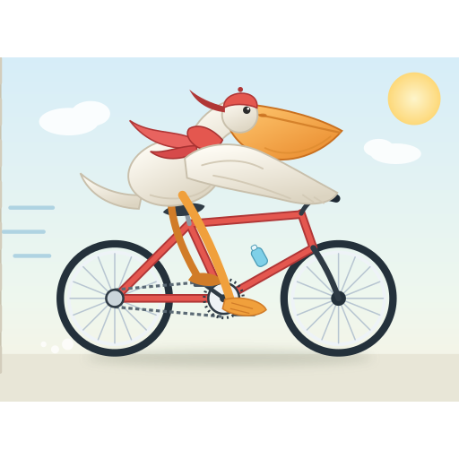

| Judge | Overall | P/B/R/C | Text reported | Original explanation |
|---|---:|---|---|---|
| astra | 9 | 2/2/2/2 | false | Expressive pelican with large pouch and sweeping wing grips bars; strong bicycle detail and coherent seated pedaling pose. |
| sol | 9 | 2/2/2/2 | false | Large graceful pelican with broad pouch, flowing scarf, clear steering and pedal contact; detailed bicycle and restrained background feel polished. |
| luna | 9 | 2/2/2/2 | false | Expressive, unmistakable pelican rides a detailed bicycle; feet align with pedals and the polished scene is well composed. |
| sonnet | 10 | 2/2/2/2 | false | Excellent: capped scarfed pelican with large pouch, detailed bike with chain and bottle, seated riding pose, sun, motion lines. |
| haiku | 8 | 2/2/2/2 | false | Pouch bill, cap and scarf make a clear pelican; seated on saddle, legs to pedals; tidy bike with bottle and clean scene. |

## P401

**gguf-iq3_xxs-medium-s33** · Human **5/10** · 35.4 s

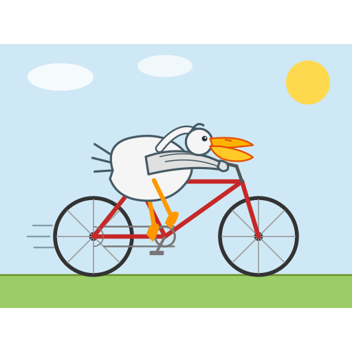

| Judge | Overall | P/B/R/C | Text reported | Original explanation |
|---|---:|---|---|---|
| astra | 4 | 1/2/1/1 | false | Open short bill lacks pelican pouch; cramped looping neck and feet hovering around crank make anatomy and riding contact confused. |
| sol | 5 | 1/2/1/1 | false | Generic open-beaked bird leans toward bars; bunched orange legs and detached lower pedal confuse riding, despite readable red bicycle. |
| luna | 8 | 2/2/2/2 | false | Distinctive double-layer pouch and bill, clear bicycle, feet at pedals, and balanced simple background. |
| sonnet | 8 | 2/2/2/2 | false | Hunched pelican with open beak and pouch, red bicycle, wing gripping bars, legs on pedals, speed lines; dynamic, slightly cramped. |
| haiku | 5 | 1/2/1/2 | false | Split orange beak with no clear pouch; bicycle is clean; body sits on the top tube, legs reach pedals. |

## P402

**gyro-s-tq1_0-medium-s33** · Human **4/10** · 41.2 s

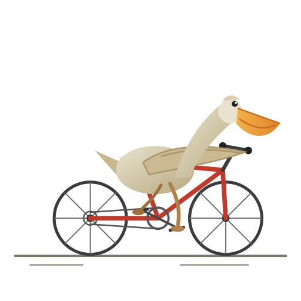

| Judge | Overall | P/B/R/C | Text reported | Original explanation |
|---|---:|---|---|---|
| astra | 5 | 2/2/1/1 | false | Pelican pouch is clear but huge diagonal neck overlays wing and body; low hanging torso and unclear feet make riding awkward. |
| sol | 6 | 2/2/2/1 | false | Long-necked pouch-billed pelican reaches bars and crank, but slanted oversized neck and low body crowd the bicycle in an ungainly pose. |
| luna | 8 | 2/2/2/2 | false | Large bill and pouch define pelican; bicycle is detailed and feet contact pedal locations in an uncluttered scene. |
| sonnet | 8 | 2/2/2/2 | false | Shaded pelican with thick curved neck, pouch, red bicycle, legs on pedals, wing to bars; clean though body sits low. |
| haiku | 6 | 2/2/1/2 | false | Clear pelican bill and pouch; full bicycle; body perched awkwardly over frame, feet on pedals. |

## P411

**gguf-iq3_xxs-high-s11** · Human **3/10** · 252.4 s

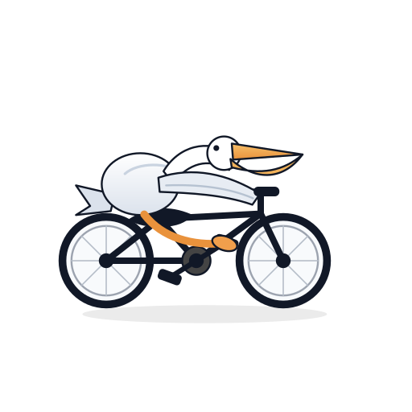

| Judge | Overall | P/B/R/C | Text reported | Original explanation |
|---|---:|---|---|---|
| astra | 7 | 2/2/1/2 | false | Crisp racing posture and pelican bill, but only one sweeping leg appears and visible lower pedal is unoccupied. |
| sol | 8 | 2/2/2/2 | false | Bold compact graphic with clear pelican bill and aerodynamic riding pose; one visible leg reaches pedal convincingly. |
| luna | 8 | 2/2/2/2 | false | Strong pelican features and bicycle silhouette; visible leg and foot reach the pedals, cleanly centered on white. |
| sonnet | 8 | 2/2/2/2 | false | Stylish tucked racing pelican with pouch, crisp bicycle and shadow; neck hidden and leg awkward but clearly riding. |
| haiku | 6 | 2/2/1/2 | false | Pouch bill reads as pelican; clean bike; body sits on frame, one leg reaches pedal, wing sits over the bars, no clear seat grip. |

## P415

**td-exl3-2.68-h6-ng8-medium-s55** · Human **5/10** · 69.0 s

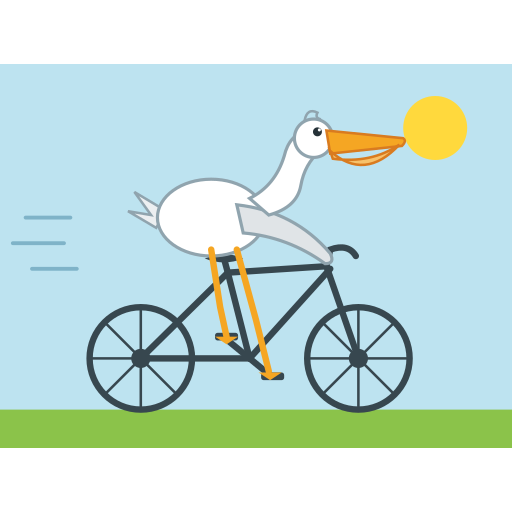

| Judge | Overall | P/B/R/C | Text reported | Original explanation |
|---|---:|---|---|---|
| astra | 8 | 2/2/2/2 | false | Clean long-necked pelican, defined pouch and reliable wing/bar and foot/pedal contacts; spare but well-balanced design. |
| sol | 8 | 2/2/2/2 | false | Clean pelican outline, distinct pouch, steering wing and feet on opposing cranks; simple but well integrated. |
| luna | 7 | 2/2/1/2 | false | Pelican bill and pouch are clear, bicycle is complete, though legs extend straight down instead of riding naturally. |
| sonnet | 8 | 2/2/2/2 | false | Pelican with pouch, long legs on pedals, wing to bars, clean bicycle, speed lines; sun overlaps beak tip. |
| haiku | 6 | 2/2/1/2 | false | Bill with lower pouch reads as pelican; clean bike; body sits above frame, legs reach pedals, wing near bars, no seat contact. |

## P416

**sc-exl3-2.05-h8-medium-s11** · Human **5/10** · 78.1 s

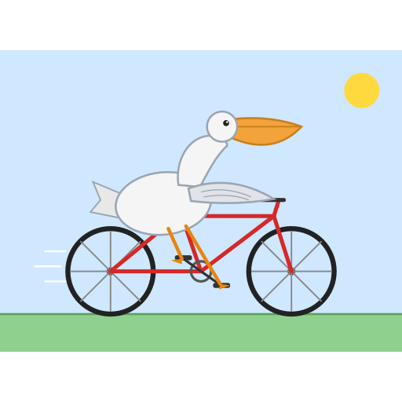

| Judge | Overall | P/B/R/C | Text reported | Original explanation |
|---|---:|---|---|---|
| astra | 7 | 2/2/2/2 | false | Clear broad pelican bill, wing at bars and feet on crank ends; blocky neck and low body are awkward but readable. |
| sol | 7 | 2/2/2/2 | false | Large bill and neck read as pelican, wing meets bar and feet meet crank; tidy drawing with somewhat stiff neck-body transition. |
| luna | 8 | 2/2/2/2 | false | Long bill and pouch make pelican clear; bicycle is complete and both feet reach pedals in a balanced frame. |
| sonnet | 7 | 2/2/2/2 | false | Pelican with long beak, no clear pouch; red bicycle, wing on bars, legs on pedals; clean but simple. |
| haiku | 5 | 1/2/1/2 | false | Wedge bill with no pouch, weakly pelican; bicycle clean; body sits over the frame, legs to pedals, wing near bars. |

## P425

**sc-exl3-2.05-h8-low-s44** · Human **3/10** · 58.2 s

| Judge | Overall | P/B/R/C | Text reported | Original explanation |
|---|---:|---|---|---|
| astra | 4 | 1/2/1/1 | false | Thin open neck and cloud obscuring beak weaken pelican identity; wing misses bars and feet bunch at crank. |
| sol | 7 | 2/2/2/2 | false | Clear pouch and bicycle, feet reach crank; simple shapes and cloud overlapping beak reduce polish. |
| luna | 6 | 1/2/2/1 | false | Bird has long bill but pouch is barely visible; bicycle and pedal contact are clear, with awkward anatomy. |
| sonnet | 5 | 2/1/1/1 | false | Long-necked pelican with pouch sits on seat, but bicycle frame is malformed (no bars or proper tubes), wing not on bars, cloud overlaps beak. |
| haiku | 6 | 1/2/2/2 | false | Long swan-like neck and flat bill with weak pouch; bicycle complete; saddle, pedals and wing on bars all touch. |

## P431

**td-exl3-2.68-h6-ng8-low-s44** · Human **6/10** · 101.6 s

| Judge | Overall | P/B/R/C | Text reported | Original explanation |
|---|---:|---|---|---|
| astra | 7 | 2/2/2/2 | false | Clear pouch, playful hat and scarf, and evident pedal/bar contacts; angular neck and straight legs keep it visually basic. |
| sol | 6 | 2/2/2/1 | false | Pouch-billed bird touches bars and pedals on clear bicycle, but angular disconnected-looking neck and sparse body details diminish polish. |
| luna | 7 | 2/2/1/2 | false | Pelican bill and subtle pouch visible, complete bicycle, but feet hang around crank rather than natural pedal posture. |
| sonnet | 7 | 2/2/2/2 | false | Pelican with hat, scarf and small pouch on red bicycle, legs on pedals, wing to bars; neck blocky, simple scene. |
| haiku | 4 | 1/2/1/1 | false | Short beak with no real pouch, so weakly pelican; bike is clear; body floats over frame, a loose red streak and detached arm look odd. |

## P437

**sc-exl3-3.05-h8-low-s22** · Human **7/10** · 86.1 s

| Judge | Overall | P/B/R/C | Text reported | Original explanation |
|---|---:|---|---|---|
| astra | 7 | 2/2/2/2 | false | Recognizable long bill and pouch, wing grips curved bars and bent legs meet pedals; plain but coherent bright scene. |
| sol | 7 | 2/2/2/2 | false | Legs align with crank and wing touches bar; recognizable pelican despite thin pouch and very simplified body. |
| luna | 7 | 1/2/2/2 | false | Long bill with faint pouch suggests a pelican; bicycle is clear and legs contact frame and crank in a simple scene. |
| sonnet | 8 | 2/2/2/2 | false | Clean flat pelican with long beak, pouch and neck, hand on bars, legs on pedals, red bicycle, sun, grass, speed lines. |
| haiku | 5 | 1/2/1/2 | false | Long bill but no clear throat pouch, so weakly pelican; clean bike; body floats above frame, feet reach pedals, wing reaches bars. |

## P442

**gyro-m-tq2_0-medium-s11** · Human **3/10** · 40.9 s

| Judge | Overall | P/B/R/C | Text reported | Original explanation |
|---|---:|---|---|---|
| astra | 7 | 2/2/2/2 | false | Simple pelican and bicycle read well with wing at bars and feet at crank ends, though stiff legs reduce dynamism. |
| sol | 8 | 2/2/2/2 | false | Recognizable pouch, balanced bicycle, seated body and wing reaching bars; feet somewhat loosely aligned with pedals. |
| luna | 8 | 2/2/2/2 | false | Pelican bill and pouch are clear; bicycle is complete and feet reach crank and pedals in a simple scene. |
| sonnet | 8 | 2/2/2/2 | false | Clean pelican with scarf, pouch, seated on dark bicycle, hand on bars, legs on pedals; sun and grass. |
| haiku | 6 | 2/2/1/2 | false | Bill with lower pouch reads as pelican; clean bike; body sits over the top tube, wing reaches bars, legs to pedals, no saddle. |

## P450

**sc-exl3-3.05-h8-high-s22** · Human **8/10** · 623.6 s

| Judge | Overall | P/B/R/C | Text reported | Original explanation |
|---|---:|---|---|---|
| astra | 8 | 2/2/2/2 | false | Large clear pouch, expressive face and good pedal stance; wing nearly reaches bars, with pleasing clean landscape and bicycle detail. |
| sol | 8 | 2/2/2/2 | false | Expressive helmeted pelican with deep pouch, clear steering and pedal contact; graceful bicycle scene, though wheels hover slightly above ground. |
| luna | 9 | 2/2/2/2 | false | Very clear pouch and pelican profile, full detailed bicycle, feet on pedals, and attractive sunny landscape. |
| sonnet | 10 | 2/2/2/2 | false | Excellent: helmeted scarfed pelican with big pouch, detailed bike with bell and chain, wing on bars, meadow, sun, speed lines. |
| haiku | 8 | 2/2/2/2 | false | Pouch bill and helmet read as pelican; seated over frame, legs to pedals, wing reaches bars; detailed bike and meadow scene. |

## P463

**td-exl3-2.68-h6-ng8-low-s33** · Human **4/10** · 86.5 s

| Judge | Overall | P/B/R/C | Text reported | Original explanation |
|---|---:|---|---|---|
| astra | 6 | 2/2/1/2 | false | Simple recognizable pelican and bicycle; round body, single merged leg and arm-like wing make contact stiff rather than natural. |
| sol | 6 | 2/2/1/2 | false | Pelican pouch and bicycle are readable; stretched humanlike steering arm and merged single leg make contact awkward despite tidy composition. |
| luna | 8 | 2/2/2/2 | false | Long bill and throat pouch distinguish the pelican; complete bicycle and seated posture with foot at pedal read clearly. |
| sonnet | 7 | 2/2/2/2 | false | Pelican with curved neck and small pouch on red bicycle, hand on bars, leg on pedal, sun, clouds; clean, body floats a bit. |
| haiku | 6 | 2/2/1/2 | false | Bill with lower pouch reads as pelican; clean bike; body sits above frame, arm reaches bars, one leg reaches pedal, no seat contact. |

## P472

**td-exl3-2.68-h6-ng8-low-s11** · Human **2/10** · 87.5 s

| Judge | Overall | P/B/R/C | Text reported | Original explanation |
|---|---:|---|---|---|
| astra | 5 | 2/1/2/1 | false | Pouch and seated pedaling bird read clearly, but open sticklike neck and missing front fork make the drawing structurally weak. |
| sol | 5 | 2/2/1/1 | false | Pouch identifies pelican, but neck is nearly empty outlines and bicycle tubes cross implausibly; thin feet and steering contact remain awkward. |
| luna | 8 | 2/2/2/2 | false | Clearly pouch-billed pelican on a complete bicycle; legs meet crank and the restrained landscape is well arranged. |
| sonnet | 7 | 2/2/2/2 | false | Pelican with pouch and very long neck seated on red bicycle, legs on pedals, thin arm to bars; clean but thin and simple. |
| haiku | 7 | 2/2/2/2 | false | Recognizable pelican with pouch bill; bicycle complete; body rests on saddle with leg to pedal; simple blob body. |

## P474

**sc-exl3-2.05-h8-high-s55** · Human **9/10** · 530.1 s

| Judge | Overall | P/B/R/C | Text reported | Original explanation |
|---|---:|---|---|---|
| astra | 9 | 2/2/2/2 | false | Polished colorful scene, prominent pouch, bent pedaling legs and wing on bars; helmet obscures much of the face. |
| sol | 9 | 2/2/2/2 | false | Richly finished cycling scene with large throat pouch, bent pedaling legs, scarf and basket; helmet obscures facial detail. |
| luna | 9 | 2/2/2/2 | false | Distinct pelican pouch and beak ride a detailed bicycle; legs reach the pedals, with polished colorful scenery. |
| sonnet | 10 | 2/2/2/2 | false | Excellent: helmeted pelican with pouch, detailed bicycle with basket, landscape, motion lines, convincing riding pose. |
| haiku | 8 | 2/2/2/2 | false | Large pouch bill and cap make a clear pelican; bicycle with basket; legs reach pedals, wing on bars; scene is well arranged. |

## P494

**td-exl3-2.18-h6-ng8-low-s44** · Human **6/10** · 101.7 s

| Judge | Overall | P/B/R/C | Text reported | Original explanation |
|---|---:|---|---|---|
| astra | 7 | 2/2/2/2 | false | Long bill with pouch and low forward riding posture read clearly; simple clean bike, though feet and crank overlap awkwardly. |
| sol | 7 | 2/2/2/2 | false | Long-necked pelican with clear pouch reaches bars and crank; coherent small bicycle, though feet are simplified splayed strokes. |
| luna | 8 | 2/2/2/2 | false | Long bill and pouch distinguish pelican; complete bicycle and feet at pedals in a clear beach-like scene. |
| sonnet | 7 | 2/2/1/2 | false | Long-beaked pelican stretched flat over red bicycle, pouch visible; legs reach pedals, wing near bars, body slightly floating. |
| haiku | 6 | 2/2/1/2 | false | Long bill with lower pouch reads as pelican; clean bike; body floats above top tube, legs reach pedals, no seat contact. |

## P507

**td-exl3-2.68-h6-ng8-medium-s22** · Human **4/10** · 88.3 s

| Judge | Overall | P/B/R/C | Text reported | Original explanation |
|---|---:|---|---|---|
| astra | 5 | 2/2/1/1 | false | Pouch-bearing bird reaches bars, but one leg ends above a detached foot and crowded angular neck weakens anatomy. |
| sol | 5 | 2/2/1/1 | false | Round pouch-billed bird and bicycle read clearly, but one leg ends abruptly and a detached foot hangs near crank. |
| luna | 8 | 2/2/2/2 | false | Pelican bill and pouch are clear, with complete bicycle and feet on pedals in a simple polished scene. |
| sonnet | 8 | 2/2/2/2 | false | Cute pelican with large pouch, red bicycle, wing on bars, legs on pedals, sun, clouds, speed lines; clean and cheerful. |
| haiku | 6 | 2/2/1/2 | false | Clear pelican with orange pouch bill; complete bicycle; body rests on top tube with no saddle, legs reach pedals. |

## P509

**gyro-m-tq2_0-high-s44** · Human **10/10** · 529.5 s

| Judge | Overall | P/B/R/C | Text reported | Original explanation |
|---|---:|---|---|---|
| astra | 9 | 2/2/2/2 | false | Beautiful coastal palette, expressive pelican with huge pouch and scarf, seated pedaling and detailed bicycle; near leg is unusually thick. |
| sol | 9 | 2/2/2/2 | false | Charming waterfront cyclist with fish-filled pouch, helmet and scarf; clear seated pedaling pose and detailed bicycle, though steering tip slightly floats. |
| luna | 9 | 2/2/2/2 | false | Distinct pelican pouch and beak ride a detailed bicycle; feet at pedals and scenic boardwalk composition is polished. |
| sonnet | 10 | 2/2/2/2 | false | Excellent: helmeted scarfed pelican with fish in pouch, bike with rear box, boardwalk, sea, sailboat, sun, birds; convincing ride. |
| haiku | 9 | 2/2/2/2 | false | Clear pelican with pouch, helmet and scarf; pannier and bike detailed; arm on bars, leg to pedal; well-composed seaside scene. |

## P519

**gyro-m-tq2_0-medium-s44** · Human **2/10** · 29.5 s

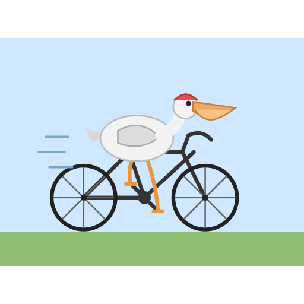

| Judge | Overall | P/B/R/C | Text reported | Original explanation |
|---|---:|---|---|---|
| astra | 6 | 2/2/1/2 | false | Simple pouch-bearing bird above recognizable bicycle, but folded wing and dangling feet provide weak riding contact. |
| sol | 6 | 2/2/1/2 | false | Recognizable simplified pouch-billed bird and bicycle; perched body and loose feet suggest riding but lack clear steering or pedal integration. |
| luna | 6 | 1/2/1/2 | false | Long bill suggests a pelican but pouch is not distinct; bicycle is clear, with legs awkwardly placed around the crank. |
| sonnet | 7 | 2/2/1/2 | false | Pelican with pouch and red cap, clear bicycle; body floats above frame, legs short of pedals, no hand on bars. |
| haiku | 6 | 2/2/1/2 | false | Pouch bill and cap read as pelican; bike is clean; body sits above the frame, legs reach pedals, no arms reach bars. |

## P521

**gguf-iq3_s-high-s22** · Human **6/10** · 542.3 s

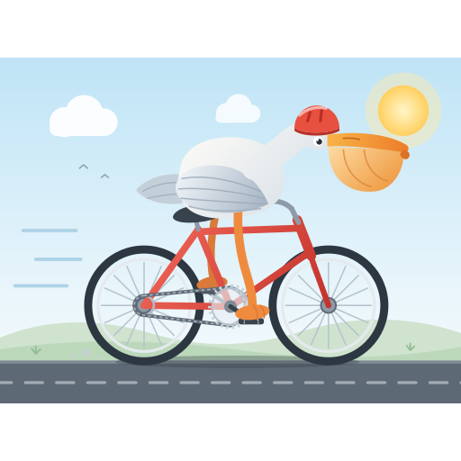

| Judge | Overall | P/B/R/C | Text reported | Original explanation |
|---|---:|---|---|---|
| astra | 8 | 2/2/2/2 | false | Large pouch, clear seated pedaling and detailed drivetrain; head-neck transition is compressed but the overall cyclist remains coherent. |
| sol | 8 | 2/2/2/2 | false | Helmeted pelican with obvious pouch sits and pedals a detailed bicycle; clean scene, though folded wing obscures much of steering pose. |
| luna | 9 | 2/2/2/2 | false | Very clear pouch-billed pelican and detailed bicycle; feet on pedals and helmeted roadside scene is strong. |
| sonnet | 9 | 2/2/2/2 | false | Polished helmeted pelican with big pouch, red bike with chain, legs on pedals, road, hills, sun, birds; no hand on bars, neck short. |
| haiku | 9 | 2/2/2/2 | false | Clear pelican with pouch and helmet; seated on saddle, legs to pedals, chain and road; well arranged. |

## P526

**sc-exl3-3.05-h8-medium-s22** · Human **3/10** · 120.9 s

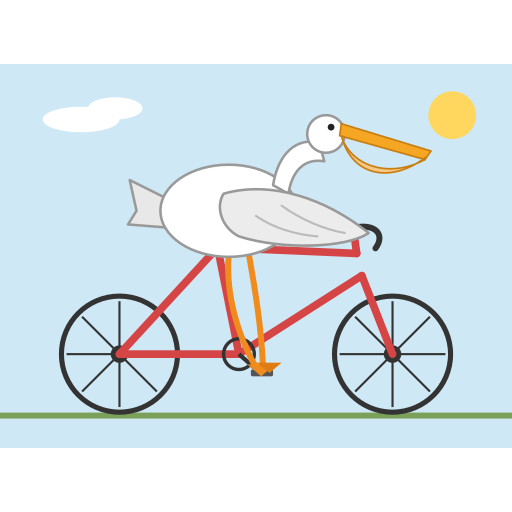

| Judge | Overall | P/B/R/C | Text reported | Original explanation |
|---|---:|---|---|---|
| astra | 5 | 2/1/1/1 | false | Clear pelican silhouette but broken steering frame and both feet converging at one pedal undermine the riding scene. |
| sol | 5 | 2/2/1/1 | false | Distinct pelican and wheels, but front frame is disconnected from handlebar assembly; merged feet and awkward neck reduce coherence. |
| luna | 8 | 2/2/2/2 | false | Long bill and pouch clearly identify pelican; full bicycle and legs reach pedals in a clean scene. |
| sonnet | 8 | 2/2/2/2 | false | Pelican with pouch and big wing on red bicycle, legs on pedals, wing to bars, sun, clouds; clean and readable. |
| haiku | 6 | 2/2/1/2 | false | Bill with lower pouch reads as pelican; clean bike; body sits over top tube, wing reaches bars, legs to pedals, no saddle. |

## P544

**sc-exl3-3.05-h8-low-s33** · Human **5/10** · 119.6 s

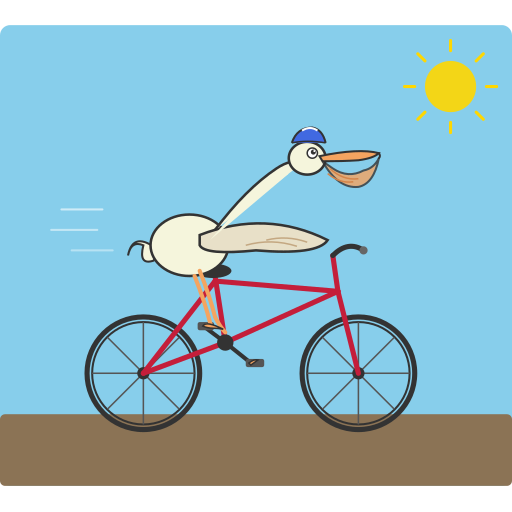

| Judge | Overall | P/B/R/C | Text reported | Original explanation |
|---|---:|---|---|---|
| astra | 4 | 1/2/1/1 | false | Cup-shaped short bill and tiny body give odd anatomy; wing misses bars and both feet bunch at one side of crank. |
| sol | 6 | 2/2/1/2 | false | Long neck and hanging pouch identify pelican; clean bicycle, but wing stops short of bars and feet bunch at crank. |
| luna | 8 | 2/2/2/2 | false | Pelican pouch and long bill identifiable, bicycle complete, and feet align with pedals in an appealing scene. |
| sonnet | 8 | 2/2/2/2 | false | Helmeted pelican with pouch and long neck, red bicycle, legs on pedals, wing stretched toward bars, sun, speed lines; tidy. |
| haiku | 7 | 2/2/2/2 | false | Pouch bill and cap read as pelican; seated on saddle with leg to pedal and wing reaching bars; simple clean scene. |

## P545

**gyro-m-tq2_0-low-s33** · Human **4/10** · 39.1 s

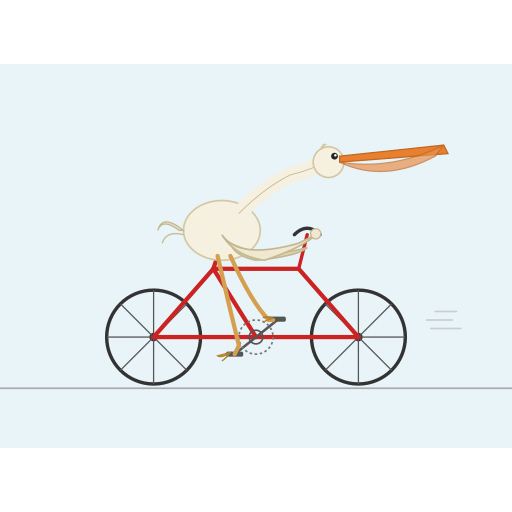

| Judge | Overall | P/B/R/C | Text reported | Original explanation |
|---|---:|---|---|---|
| astra | 7 | 2/2/2/2 | false | Very long bill and pouch identify pelican; wing reaches bars and feet align near pedals, though anatomy is thin and stylized. |
| sol | 7 | 2/2/2/2 | false | Long bill with visible pouch and wing on bars; both feet approach pedals on a clean small bicycle, with delicate low-contrast outlines. |
| luna | 7 | 2/2/2/2 | false | Long bill and throat pouch indicate pelican; complete bicycle and legs meet pedals in a minimal composition. |
| sonnet | 7 | 2/2/1/2 | false | Long-necked pelican with long beak and thin pouch above red bicycle; legs reach pedals, wing near bars, body floats above seat. |
| haiku | 5 | 2/2/1/2 | false | Long bill with lower pouch reads as pelican; bike is clean; body sits over frame, legs reach pedals, wing near bars, faint seat contact. |

## P549

**td-exl3-2.68-h6-ng8-high-s11** · Human **8/10** · 939.9 s

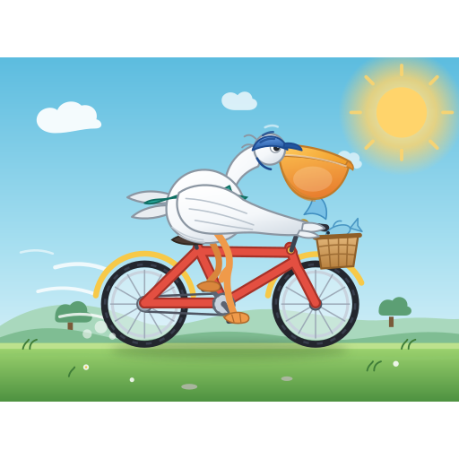

| Judge | Overall | P/B/R/C | Text reported | Original explanation |
|---|---:|---|---|---|
| astra | 9 | 2/2/2/2 | false | Characterful pelican with prominent pouch and convincing grip; detailed bicycle, fenders and fish basket in lively balanced landscape. |
| sol | 9 | 2/2/2/2 | false | Expressive pelican with large pouch, steering wing and bent pedaling legs; colorful detailed bicycle and fish basket in polished countryside setting. |
| luna | 9 | 2/2/2/2 | false | Vivid, clearly pelican-shaped bird with pouch rides a detailed bicycle; feet meet pedals and scenery is lively. |
| sonnet | 10 | 2/2/2/2 | false | Excellent: capped pelican with pouch and fish, basket, fenders, detailed red bike, meadow, sun, motion; riding convincingly. |
| haiku | 8 | 2/2/2/2 | false | Big pouch bill and cap read as pelican; bike with fenders and basket; wing reaches bars, legs to pedals; well-arranged meadow scene. |

## P563

**gyro-s-tq1_0-high-s44** · Human **3/10** · 237.0 s

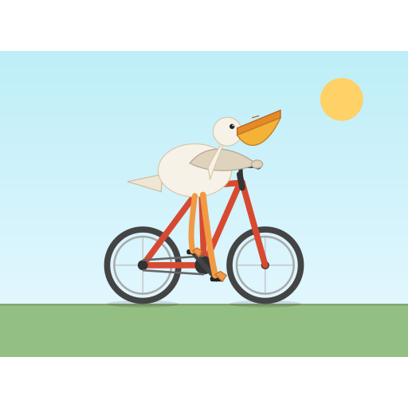

| Judge | Overall | P/B/R/C | Text reported | Original explanation |
|---|---:|---|---|---|
| astra | 6 | 2/2/1/2 | false | Clear upward bill pouch and bicycle, but angular crossed neck and short wing hovering above stem make anatomy and steering awkward. |
| sol | 7 | 2/2/2/2 | false | Compact pelican with upturned pouch bill steers and pedals a small bicycle; clean geometric design, though front wheel lacks spokes. |
| luna | 6 | 2/1/2/1 | false | Pelican is clear and seated with feet on pedals; bicycle wheels and basic frame are present but simplified and incomplete. |
| sonnet | 8 | 2/2/2/2 | false | Compact pelican with pouch on red bicycle, hand on bars, legs on pedals, gradient sky, sun, grass; tidy, short neck. |
| haiku | 6 | 2/2/1/2 | false | Broad orange bill reads as pelican; bicycle is clean; body rests on the top tube with no saddle, legs to pedals. |

## P575

**td-exl3-2.18-h6-ng8-medium-s44** · Human **3/10** · 60.9 s

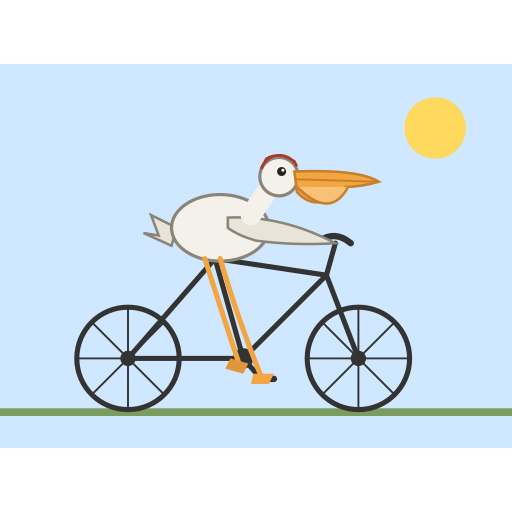

| Judge | Overall | P/B/R/C | Text reported | Original explanation |
|---|---:|---|---|---|
| astra | 6 | 2/2/1/2 | false | Readable pouch and clean bicycle, but stiff parallel legs and unclear crank connections make the pose less convincing. |
| sol | 6 | 2/2/1/2 | false | Clear pouch and neat bicycle, with wing on bars; parallel legs and oversized feet converge below an unclear crank rather than natural pedaling. |
| luna | 8 | 2/2/2/2 | false | Clear pelican bill and pouch, recognizable bicycle and legs on pedals; clean, readable side view. |
| sonnet | 7 | 2/2/2/2 | false | Pelican with pouch on dark bicycle, wing to bars, long legs on pedals, sun; clean but plain and neck short. |
| haiku | 6 | 2/2/1/2 | false | Bill with lower pouch reads as pelican; clean bike; body sits on top tube, wing reaches bars, legs to pedals, no saddle. |

## P581

**td-exl3-2.18-h6-ng8-high-s44** · Human **6/10** · 687.5 s

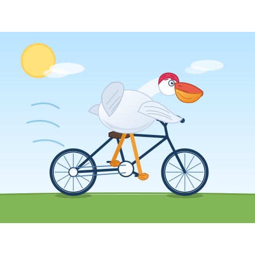

| Judge | Overall | P/B/R/C | Text reported | Original explanation |
|---|---:|---|---|---|
| astra | 7 | 1/2/2/2 | false | Nicely detailed cyclist with wings and pedal contact, but short rounded bill reads more ducklike than pelican. |
| sol | 7 | 1/2/2/2 | false | Attractive helmeted bird convincingly seated and steering; short rounded bill resembles a duck more than a long-billed pelican. |
| luna | 9 | 2/2/2/2 | false | Distinct pelican head and pouch, detailed bicycle, and feet placed at pedals make a convincing, attractive ride. |
| sonnet | 8 | 2/2/2/2 | false | Shaded pelican with red-capped head and pouch on navy bicycle, legs on pedals, wing to bars, sun, wind lines; neck hidden. |
| haiku | 7 | 2/2/2/2 | false | Pouch bill and cap read as pelican; saddle, legs to pedals and wing on bars; head sits detached from the body. |

## P595

**gguf-iq3_s-medium-s55** · Human **6/10** · 32.5 s

| Judge | Overall | P/B/R/C | Text reported | Original explanation |
|---|---:|---|---|---|
| astra | 8 | 2/2/2/2 | false | Bold clear pelican and complete bicycle, wing touches bars and feet meet opposing pedals; balanced simple illustration with stiff neck. |
| sol | 7 | 2/2/2/2 | false | Clear pouch-billed pelican seated over frame, wing reaches bar and feet meet opposing pedals; clean but angular basic illustration. |
| luna | 8 | 2/2/2/2 | false | Pelican pouch and long bill, clear bicycle frame, and legs connected to pedals in a crisp composition. |
| sonnet | 8 | 2/2/2/2 | false | Bold-outlined pelican with pouch on orange bicycle, wing to bars, legs on pedals, sun, clouds, speed lines; clean and legible. |
| haiku | 6 | 2/2/1/2 | false | Bill with lower pouch reads as pelican; clean bike; body sits over the top tube, wing reaches bars, legs to pedals, no saddle. |

## P597

**gguf-iq3_xxs-low-s33** · Human **4/10** · 37.1 s

| Judge | Overall | P/B/R/C | Text reported | Original explanation |
|---|---:|---|---|---|
| astra | 7 | 2/2/1/2 | false | Appealing pelican and bold bicycle, but parallel legs converge awkwardly and handlebar stem appears disconnected. |
| sol | 4 | 2/1/1/1 | false | Recognizable pelican sits above bicycle-like wheels, but broken steering stem, chain routed between wheel hubs and merged feet undermine mechanical coherence. |
| luna | 8 | 2/2/2/2 | false | Clear pelican bill and pouch, full bicycle, and legs down to crank in a neatly framed roadway scene. |
| sonnet | 8 | 2/2/2/2 | false | Pelican with curved neck and pouch seated on crimson bicycle, legs on pedals, arm toward bars, road, sun, cloud; clean. |
| haiku | 8 | 2/2/2/2 | false | Clear pouch bill and long neck; seated on saddle, legs to pedals, wing on bars; clean road scene. |

## P617

**gyro-m-tq2_0-medium-s55** · Human **3/10** · 42.1 s

| Judge | Overall | P/B/R/C | Text reported | Original explanation |
|---|---:|---|---|---|
| astra | 7 | 2/2/2/2 | true | Low forward pelican posture, distinctive pouch and clear bar/pedal contacts; dark legs blend with frame, reducing immediate legibility. |
| sol | 7 | 2/2/2/2 | true | Long pouch bill, steering wing and opposed feet communicate cyclist clearly; clean compact layout, though narrow neck and gray legs are schematic. |
| luna | 8 | 2/2/2/2 | true | Clear pouch-billed pelican rides a well-drawn bicycle with feet on pedals; text is present but disregarded. |
| sonnet | 8 | 2/2/2/2 | true | Stylish low-slung pelican with pouch on navy bicycle, legs on pedals, wing to bars, shadow; clean flat design, caption ignored. |
| haiku | 4 | 1/2/1/2 | true | Wedge bill with little pouch, weakly pelican; bike clean; body rests on top tube, no visible leg or seat contact. Caption ignored. |

## P618

**td-exl3-2.68-h6-ng8-medium-s33** · Human **6/10** · 166.7 s

| Judge | Overall | P/B/R/C | Text reported | Original explanation |
|---|---:|---|---|---|
| astra | 8 | 2/2/2/2 | false | Distinct pouch and curved neck, wing reaches bar and bent legs meet opposing pedals; tidy bicycle and balanced simple setting. |
| sol | 8 | 2/2/2/2 | false | Distinct hanging pouch, smooth curved neck and wing reaching handlebar; feet meet opposed pedals on clean chain-driven bicycle. |
| luna | 8 | 2/2/2/2 | false | Clear pelican bill and pouch with complete bicycle; feet meet pedals and shapes are cleanly arranged. |
| sonnet | 9 | 2/2/2/2 | false | Polished scene: clear pelican with pouch, teal bicycle, legs on pedals, wing on bars, sky and grass. |
| haiku | 6 | 2/2/1/2 | false | Bill with lower pouch reads as pelican; clean bike; body sits over top tube, wing reaches bars, legs to pedals, no saddle. |

## P622

**td-exl3-2.18-h6-ng8-medium-s55** · Human **4/10** · 134.8 s

| Judge | Overall | P/B/R/C | Text reported | Original explanation |
|---|---:|---|---|---|
| astra | 7 | 2/2/2/2 | false | Clear pouch and plausible contacts on a simple bicycle; helmet hides face and angular neck feels mechanical. |
| sol | 7 | 2/2/2/2 | false | Clear pouch, pedaling legs and wing on bar; simple tidy drawing, but head lacks a visible eye. |
| luna | 8 | 2/2/2/2 | false | Pelican bill and pouch are visible, with recognizable bicycle and feet at pedal locations in a clear arrangement. |
| sonnet | 8 | 2/2/2/2 | false | Helmeted pelican with pouch, orange bicycle, arm to bars, legs on pedals, speed lines and shadow; clean. |
| haiku | 5 | 2/2/1/2 | false | Pouch bill and cap read as pelican; bike clean; blank oval body floats above the frame, wing reaches bars, one leg to pedal. |

## P629

**td-exl3-2.18-h6-ng8-low-s11** · Human **3/10** · 117.0 s

| Judge | Overall | P/B/R/C | Text reported | Original explanation |
|---|---:|---|---|---|
| astra | 5 | 2/2/1/1 | false | Pelican has distinctive fish-filled pouch, but tiny cyclist floats above broad ground shadow and feet miss obvious pedal positions. |
| sol | 6 | 2/2/1/2 | false | Recognizable pelican with fish-filled pouch and neat bicycle; feet miss cranks and wheels float above the ground. |
| luna | 7 | 2/2/1/2 | false | Small but recognizable pelican with pouch and bicycle; legs dangle, making riding pose less convincing. |
| sonnet | 9 | 2/2/2/2 | false | Charming scene: pelican with fish in pouch, red cap, clean bicycle, legs on pedals, sun, clouds, motion lines. |
| haiku | 6 | 2/2/1/2 | false | Pouch bill with a fish reads as pelican; bike clean; body sits on top tube with legs to pedals and no clear saddle contact. |

## P640

**gguf-iq3_s-low-s22** · Human **1/10** · 38.7 s

| Judge | Overall | P/B/R/C | Text reported | Original explanation |
|---|---:|---|---|---|
| astra | 4 | 1/1/1/1 | false | Circular generic bird with short bill, detached tail and floating handlike wing; bicycle steering assembly is visibly disconnected. |
| sol | 4 | 1/1/1/1 | false | Round bird with short pouch-like bill above malformed bicycle; detached fork and tail, unclear handlebar and mismatched feet break structure. |
| luna | 7 | 2/2/2/2 | false | Pelican and bicycle are readable, with legs down to pedals; frame has a missing fork segment but overall scene is clean. |
| sonnet | 6 | 2/2/1/1 | false | Pelican with pouch and neck, red bicycle; huge body sits over frame, legs straight down to pedals, hand not on bars, frame broken. |
| haiku | 4 | 2/2/1/1 | false | Pouch bill reads as pelican; bike frame is odd with a broken rear triangle; body floats above frame, legs pass through it. |

## P645

**td-exl3-2.18-h6-ng8-medium-s11** · Human **6/10** · 98.3 s

| Judge | Overall | P/B/R/C | Text reported | Original explanation |
|---|---:|---|---|---|
| astra | 7 | 2/2/1/2 | false | Compact clean pelican with clear pouch and wing at bars, though both legs converge onto one pedal. |
| sol | 6 | 2/2/1/2 | false | Distinct pouch and steering wing on clear red bicycle; legs converge into overlapping feet at one pedal, making riding stiff. |
| luna | 7 | 2/2/1/2 | false | Pouch-billed pelican and bicycle are clear, but only one foot is visible near the crank and pose is awkward. |
| sonnet | 8 | 2/2/2/2 | false | Pelican with big pouch, red bicycle, legs on pedals, wing to bars, speed lines, sun and grass; tidy. |
| haiku | 7 | 2/2/2/2 | false | Clear pouch bill; seated on saddle with wing reaching bars and a leg to the pedal; clean simple scene. |

## P649

**gyro-m-tq2_0-low-s44** · Human **3/10** · 32.7 s

| Judge | Overall | P/B/R/C | Text reported | Original explanation |
|---|---:|---|---|---|
| astra | 4 | 1/1/1/1 | true | Round generic bird with shallow bill; bicycle lacks front fork and coherent crank while legs extend loosely toward separate black marks. |
| sol | 4 | 1/1/1/1 | true | Bird has short bill and round body; bicycle frame lacks convincing saddle and crank structure, with stretched diagonal limb. |
| luna | 7 | 2/2/1/2 | true | Pelican with pouch and bicycle are clear, but feet hover below the frame; caption is present and disregarded. |
| sonnet | 7 | 2/2/2/2 | true | Pelican with pouch, arm to bars, legs reach pedals on red bicycle; seat missing and body floats, simple scene. |
| haiku | 5 | 1/2/1/2 | true | Flat wedge bill with little pouch; bicycle clean; body sits over the frame, arm reaches bars, legs to pedals. Caption ignored. |

## P670

**gyro-m-tq2_0-low-s55** · Human **7/10** · 45.8 s

| Judge | Overall | P/B/R/C | Text reported | Original explanation |
|---|---:|---|---|---|
| astra | 5 | 1/2/1/2 | true | Small generic long-necked bird sits over bicycle; shallow bill and folded wing lack pelican specificity and convincing steering. |
| sol | 6 | 1/2/1/2 | true | Neat bicycle and perched bird, but short bill and minimal pouch weaken pelican identity; wing does not reach steering. |
| luna | 6 | 1/2/1/1 | true | Long bill suggests pelican but pouch is slight; bicycle is clear, while legs cluster awkwardly. Small text ignored. |
| sonnet | 8 | 2/2/2/2 | true | Neat pelican with dark wing, pouch, red crest, red bicycle with chain, seated on pedals and bars; clean flat style, small caption. |
| haiku | 5 | 1/2/1/2 | true | Bill is pelican-like but pouch is faint; bicycle clean; body sits on frame with legs to pedals; caption text ignored. |

## P676

**td-exl3-2.18-h6-ng8-high-s11** · Human **3/10** · 557.0 s

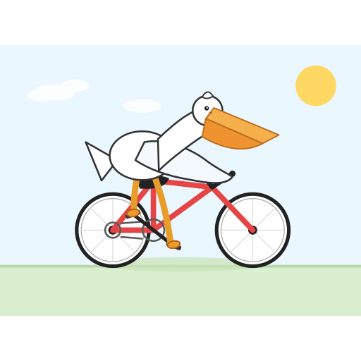

| Judge | Overall | P/B/R/C | Text reported | Original explanation |
|---|---:|---|---|---|
| astra | 6 | 2/2/2/1 | false | Large pouch and pedal contacts read clearly, but blocky intersecting neck and wing polygons create awkward anatomy over the bike. |
| sol | 8 | 2/2/2/2 | false | Distinct broad pouch and forward-reaching wing; feet meet opposed cranks on clear bicycle, with angular but cohesive styling. |
| luna | 8 | 2/2/2/2 | false | Large beak and pouch clearly signal pelican; bicycle is recognizable and feet align with crank and pedals. |
| sonnet | 8 | 2/2/2/2 | false | Pelican with big angular pouch seated on red bicycle, legs on pedals, wing to bars, sun and grass; compact and tidy. |
| haiku | 8 | 2/2/2/2 | false | Clear pouch bill and long neck; seated on saddle, legs to pedals, wing reaches bars; clean line-art bicycle. |

## P691

**gguf-iq3_xxs-low-s22** · Human **2/10** · 46.2 s

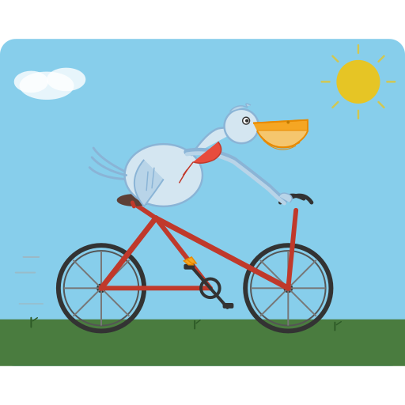

| Judge | Overall | P/B/R/C | Text reported | Original explanation |
|---|---:|---|---|---|
| astra | 3 | 2/1/0/1 | false | Pelican floats above malformed bicycle; legs are absent except an isolated foot and steering handle floats above fork. |
| sol | 5 | 2/2/1/1 | false | Pelican and bicycle recognizable, but missing visible legs, disconnected handlebar stem and awkward frame compromise riding coherence. |
| luna | 6 | 2/2/1/1 | false | Pelican pouch and bicycle are clear, but one leg is disconnected from the pedals and frame has a malformed top section. |
| sonnet | 7 | 2/2/1/2 | false | Blue-tinted pelican with pouch and scarf, red bicycle with arm to bars; body floats above seat, legs missing, frame slightly skewed. |
| haiku | 8 | 2/2/2/2 | false | Clear pelican with pouch bill on a clean bicycle; body sits on saddle, wing touches bars; scene is tidy. |

## P695

**sc-exl3-3.05-h8-high-s11** · Human **8/10** · 721.4 s

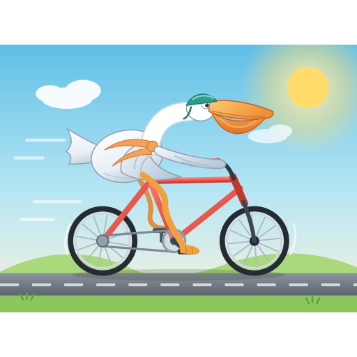

| Judge | Overall | P/B/R/C | Text reported | Original explanation |
|---|---:|---|---|---|
| astra | 8 | 2/2/2/2 | false | Long curved neck and broad pouch clearly identify pelican; forward wing and bent legs convey cycling in a polished colorful scene. |
| sol | 8 | 2/2/2/2 | false | Stylish helmeted pelican with strong pouch and curved neck, pedaling feet and steering wing; pleasant scene despite slightly loose bicycle geometry. |
| luna | 9 | 2/2/2/2 | false | Distinctive pelican pouch and body on a clear bicycle; legs meet pedals, with energetic, polished scenery. |
| sonnet | 9 | 2/2/2/2 | false | Helmeted pelican with pouch, wing on bars, red bicycle, road, hills, sun, speed lines; legs a bit tangled but vivid. |
| haiku | 8 | 2/2/2/2 | false | Pouch bill reads as pelican; clean bike; seated over frame, legs to pedals, arm reaches bars; road scene is clean and dynamic. |

## P709

**gguf-iq3_s-medium-s33** · Human **7/10** · 65.2 s

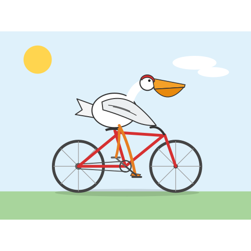

| Judge | Overall | P/B/R/C | Text reported | Original explanation |
|---|---:|---|---|---|
| astra | 7 | 2/2/2/2 | false | Simple clear pouch and seated bird with wing at bars and feet at pedals; tidy bicycle though neck contrast is weak. |
| sol | 7 | 2/2/2/2 | false | Clean modest illustration with clear pouch, seated body, steering wing and feet on pedals; minimal but coherent. |
| luna | 8 | 2/2/2/2 | false | Large bill and pouch clearly read pelican; full bicycle with legs positioned at pedals in a tidy landscape. |
| sonnet | 8 | 2/2/2/2 | false | Pelican with pouch and capped head seated on red bicycle, wing to bars, leg on pedals, sun, clouds, shadow; clean, short neck. |
| haiku | 6 | 2/2/1/2 | false | Bill with lower pouch reads as pelican; clean bike; body sits above top tube, legs reach pedals, wing near bars, no clear seat contact. |

## P713

**td-exl3-2.68-h6-ng8-medium-s11** · Human **2/10** · 48.8 s

| Judge | Overall | P/B/R/C | Text reported | Original explanation |
|---|---:|---|---|---|
| astra | 5 | 1/2/1/2 | false | Generic short-billed bird perched above bicycle; one straight leg reaches pedal while wing stays folded and saddle sits below body. |
| sol | 6 | 2/2/1/2 | false | Simple pouch-billed bird and clear bicycle; single straight leg and no steering contact make riding stiff. |
| luna | 5 | 1/2/1/1 | false | Long bill and body resemble a pelican but pouch is subtle; bicycle is clear, while only one leg and foot show. |
| sonnet | 6 | 2/2/1/2 | false | Pelican with pouch and curved neck above red bicycle seat; single leg, no hand on bars, body floating; bike clean. |
| haiku | 4 | 1/2/1/2 | false | Wedge bill with no pouch reads as generic bird; bike clean; body sits on saddle area with one leg, no arms reach bars. |

## P725

**gyro-s-tq1_0-high-s22** · Human **2/10** · 263.6 s

| Judge | Overall | P/B/R/C | Text reported | Original explanation |
|---|---:|---|---|---|
| astra | 7 | 2/2/1/2 | false | Bold charming pelican with generous pouch and pedaling feet, but front controls disappear behind the head and riding posture is awkward. |
| sol | 6 | 2/2/1/2 | false | Charming big-pouched bird and bright bicycle, but body floats over saddle and bill hides steering; pedal arrangement feels stretched. |
| luna | 7 | 2/2/1/1 | false | Pelican and bicycle are unmistakable, but oversized pouch obscures much of the bike and feet do not align convincingly. |
| sonnet | 6 | 2/2/1/1 | false | Pelican with pouch lying over the frame, covers bars; legs awkwardly bent, seat detached. Bike clear but pose odd. |
| haiku | 6 | 2/2/1/2 | false | Pouch-shaped bill reads as pelican; bike clear; seated on saddle with legs to pedals, but no arms reach the bars. |

## P726

**td-exl3-2.18-h6-ng8-high-s33** · Human **3/10** · 617.8 s

| Judge | Overall | P/B/R/C | Text reported | Original explanation |
|---|---:|---|---|---|
| astra | 8 | 2/2/2/2 | false | Dynamic forward lean, distinct pouch and wing on bars; feet align with crank despite simplified rear body anatomy. |
| sol | 8 | 2/2/2/2 | false | Expressive helmeted pelican with distinct pouch, outstretched steering wing and opposed feet; balanced graphic bicycle with crisp spokes. |
| luna | 8 | 2/2/2/2 | false | Clear pelican and complete bicycle; bird is seated with feet at pedals, in a clean side-view scene. |
| sonnet | 9 | 2/2/2/2 | false | Dynamic aerodynamic pose: helmeted pelican with pouch, wing on bars, legs on pedals, detailed spoked wheels, shadow. |
| haiku | 8 | 2/2/2/2 | false | Clear pouch bill reads as pelican; clean bike; body on frame, legs reach pedals, wing rests on bars. |

## P727

**gyro-s-tq1_0-low-s44** · Human **1/10** · 27.1 s

| Judge | Overall | P/B/R/C | Text reported | Original explanation |
|---|---:|---|---|---|
| astra | 4 | 1/2/1/1 | false | Tiny beak barely suggests pelican; bicycle floats well above ground, handlebars branch oddly and feet miss clear pedal contact. |
| sol | 5 | 1/2/1/1 | false | Tiny short bill and round body read as generic bird; awkward branching handlebars and floating bicycle weaken an otherwise readable concept. |
| luna | 5 | 1/2/1/1 | false | Bird lacks a prominent pelican bill or pouch; bicycle is clear, but the floating pose and disjoint controls weaken riding. |
| sonnet | 5 | 1/2/2/1 | false | Bird with thin beak and tiny pouch seated on bicycle, hand on bars, feet on pedals; weak pelican traits, bike floats above ground. |
| haiku | 5 | 1/2/2/1 | false | Thin bill with no visible pouch, so weakly pelican; bicycle and saddle are solid; body sits and hands reach bars; ground is an odd ellipse. |

## P731

**gguf-iq3_xxs-low-s55** · Human **2/10** · 36.4 s

| Judge | Overall | P/B/R/C | Text reported | Original explanation |
|---|---:|---|---|---|
| astra | 4 | 1/1/1/1 | false | Thin split bill lacks pouch, bicycle crank hangs disconnected from frame and parallel feet bunch together despite wing reaching bars. |
| sol | 5 | 1/2/1/1 | false | Thin open beak lacks distinctive pouch; skeletal wing reaches bar but legs merge at crank, with odd raised wing and sparse bicycle frame. |
| luna | 5 | 1/2/1/1 | false | Long bill and slight pouch suggest a pelican; bicycle is clear, but feet hang together below frame with weak riding pose. |
| sonnet | 6 | 1/2/2/2 | false | Seated bird with arm to bars, legs on pedals, clean bicycle; beak thin with small pouch, so only weakly pelican-like. |
| haiku | 5 | 1/2/1/2 | false | Narrow bill with faint pouch, weakly pelican; bicycle clean; body sits over the frame, wing reaches bars, no clear saddle. |

## P741

**td-exl3-2.68-h6-ng8-medium-s44** · Human **3/10** · 176.0 s

| Judge | Overall | P/B/R/C | Text reported | Original explanation |
|---|---:|---|---|---|
| astra | 8 | 2/2/2/2 | false | Clean athletic pelican with clear pouch, wing at curved bars and feet on opposing pedals; strong simple bike silhouette. |
| sol | 8 | 2/2/2/2 | false | Clear capped pelican with long pouch bill, wing on drop bars and feet on opposing pedals; crisp bicycle and lively balanced pose. |
| luna | 8 | 2/2/2/2 | false | Distinct pelican pouch and bill on complete bicycle; legs connect to crank, with clean, readable lines. |
| sonnet | 9 | 2/2/2/2 | false | Cap-wearing pelican with big pouch, red bicycle with chain, wing on bars, legs on pedals, speed lines, shadow; clean, confident. |
| haiku | 8 | 2/2/2/2 | false | Clear pouch bill; clean bike; body sits on frame, legs reach pedals, wing reaches bars; simple and well arranged. |

## P743

**sc-exl3-2.05-h8-low-s22** · Human **4/10** · 67.3 s

| Judge | Overall | P/B/R/C | Text reported | Original explanation |
|---|---:|---|---|---|
| astra | 4 | 1/1/1/1 | false | Head and triangular neck float apart from body; shallow bill and incomplete bicycle frame weaken otherwise visible wing and pedal contacts. |
| sol | 6 | 2/2/2/1 | false | Clear bicycle and pedal contact, but neck appears disconnected from body; simplistic bird silhouette reduces coherence. |
| luna | 8 | 2/2/2/2 | false | Pelican with pouch and long bill rides a complete bicycle, feet touching pedals in a bold, simple landscape. |
| sonnet | 6 | 1/2/2/2 | false | Bird with long beak but no real pouch, seated on red bicycle with hand on bars, legs on pedals; clean but generic. |
| haiku | 5 | 1/2/2/2 | false | Long bill but no throat pouch, so weakly pelican; bike clear; seated on saddle, legs reach pedals, wing rests near bars. |

## P769

**td-exl3-2.18-h6-ng8-low-s33** · Human **3/10** · 129.4 s

| Judge | Overall | P/B/R/C | Text reported | Original explanation |
|---|---:|---|---|---|
| astra | 5 | 2/2/1/1 | false | Pelican pouch and bicycle are recognizable, but entire bicycle floats above ground and short wing stops before handlebar. |
| sol | 7 | 2/2/1/2 | false | Pleasant detailed pelican and bicycle; feet loosely meet crank but wings miss bars and bicycle floats above ground. |
| luna | 7 | 2/2/1/2 | false | Long bill and pouch identify a pelican, with a complete bicycle; legs dangle around pedals rather than forming a firm riding pose. |
| sonnet | 8 | 2/2/2/2 | false | Shaded pelican with pouch, blue bicycle with chain, legs on pedals, wing to bars, sun, speed lines; bike floats above grass, thin neck. |
| haiku | 5 | 2/2/1/1 | false | Pouch bill reads as pelican; bike is clean but floats above the ground shadow; body sits over frame, wing near bars, no saddle. |

## P777

**gguf-iq3_s-low-s33** · Human **4/10** · 45.2 s

| Judge | Overall | P/B/R/C | Text reported | Original explanation |
|---|---:|---|---|---|
| astra | 6 | 2/2/1/2 | false | Small pouch-bearing bird reaches handlebars, but feet float around an unclear crank and chain geometry is misplaced. |
| sol | 6 | 1/2/2/2 | false | Small long-necked bird steers and pedals clearly; short round bill weakens pelican recognition, and bicycle rear triangle is oddly looped. |
| luna | 8 | 2/2/2/2 | false | Long bill and pouch clearly identify pelican; recognizable bicycle and balanced seated posture with feet by pedals. |
| sonnet | 7 | 2/2/2/2 | false | Neat long-necked pelican with pouch, hand on bars, legs on pedals, red bicycle; beak short and background plain. |
| haiku | 5 | 1/2/1/2 | false | Orange bill is wedge-shaped with no clear pouch; bicycle clean; body floats above frame, arm reaches bars, legs to pedals. |

## P779

**gguf-iq3_s-medium-s11** · Human **5/10** · 54.8 s

| Judge | Overall | P/B/R/C | Text reported | Original explanation |
|---|---:|---|---|---|
| astra | 6 | 2/1/2/1 | false | Clear pelican and strong pedal/bar contact, but missing front fork leaves wheel disconnected from steering assembly. |
| sol | 8 | 2/2/2/2 | false | Crisp simple pelican with obvious pouch, wing wrapped to bars and feet on opposing pedals; coherent seated pose and clean bicycle. |
| luna | 8 | 2/2/2/2 | false | Strong pelican silhouette and clean two-wheel bicycle; bird is seated with feet meeting crank and pedals. |
| sonnet | 8 | 2/2/2/2 | false | Bold clean pelican with big pouch, blue bicycle, arm to bars, legs on pedals, speed lines; bold outlines, simple. |
| haiku | 7 | 2/2/2/2 | false | Pouch bill reads as pelican; clean bike; body sits on the frame with legs to pedals and wing reaching bars. |

## P788

**gyro-s-tq1_0-medium-s44** · Human **1/10** · 44.1 s

| Judge | Overall | P/B/R/C | Text reported | Original explanation |
|---|---:|---|---|---|
| astra | 5 | 2/2/1/1 | false | Huge pouch is recognizable but overlaps steering column; tiny body, thick pale legs and absent handlebar contact feel assembled awkwardly. |
| sol | 5 | 2/2/1/1 | false | Huge angled pouch covers face and handlebar; white legs meet pedals but no steering wing and disconnected-looking neck make pose awkward. |
| luna | 6 | 2/2/1/1 | false | Pelican bill and body are recognizable with a clear bicycle, but head and body are disconnected and riding pose is awkward. |
| sonnet | 7 | 2/2/2/2 | false | Pelican with oversized pouch pointing down, seated on red bicycle with legs on pedals; no hand on bars, pouch covers beak. |
| haiku | 5 | 2/2/1/1 | false | Oversized pouch bill reads as pelican; body floats on the frame with no saddle; head and bill placement is awkward. |

## P790

**gyro-s-tq1_0-medium-s55** · Human **2/10** · 44.9 s

| Judge | Overall | P/B/R/C | Text reported | Original explanation |
|---|---:|---|---|---|
| astra | 6 | 2/2/1/2 | false | Recognizable pouch and tidy bicycle, but tail floats detached and only one leg and vague wing reach support riding. |
| sol | 6 | 2/2/1/2 | false | Neat small pelican with orange pouch on clear red bicycle; one visible leg and curled wing offer only tentative riding contact. |
| luna | 7 | 2/2/1/2 | false | Pelican bill and pouch visible with a full bicycle; only one leg is apparent and riding contact is imperfect. |
| sonnet | 6 | 2/2/1/2 | false | Pelican with pouch perched over seat on clean red bicycle; single leg hangs, no hand on bars, short neck, plain. |
| haiku | 5 | 2/2/1/2 | false | Bill with lower pouch reads as pelican; bike is clear; body sits over the frame, one leg reaches pedal, no arms reach bars. |

## P801

**gguf-iq3_s-high-s44** · Human **8/10** · 317.9 s

| Judge | Overall | P/B/R/C | Text reported | Original explanation |
|---|---:|---|---|---|
| astra | 9 | 2/2/2/2 | false | Distinct elegant pelican with broad pouch, feathered wing gripping bars and well-placed pedaling legs; balanced detailed outdoor scene. |
| sol | 9 | 2/2/2/2 | false | Distinct long-billed pelican with deep pouch and natural cycling posture; clear steering and pedal contact, detailed bicycle and harmonious landscape. |
| luna | 9 | 2/2/2/2 | false | Prominent pelican pouch and bill, detailed bicycle, and feet contacting pedals in a polished landscape. |
| sonnet | 9 | 2/2/2/2 | false | Polished pelican with huge pouch, scarf, red bike with chain, seated on seat, wing to bars, hills, sun, wind lines. |
| haiku | 8 | 2/2/2/2 | false | Big pouch bill reads as pelican; seated on saddle, legs to pedals, wing reaches bars; clean bike and sunny scene. |

## P804

**td-exl3-2.18-h6-ng8-high-s22** · Human **3/10** · 275.2 s

| Judge | Overall | P/B/R/C | Text reported | Original explanation |
|---|---:|---|---|---|
| astra | 4 | 1/2/1/1 | false | Bicycle is readable, but overlapping head, beak and oversized wing confuse bird anatomy; only one leg appears. |
| sol | 6 | 1/2/2/2 | false | Low cycling posture and clear bicycle work, but odd open rounded bill lacks a convincing pelican throat pouch. |
| luna | 5 | 1/2/1/1 | false | Overlapping shapes obscure pelican pouch and bicycle frame; one leg reaches crank but overall pose is unclear. |
| sonnet | 6 | 2/2/1/1 | false | Flat tucked pelican with beak on teal bicycle; one leg only, neck hidden, wing on bars; clear but cramped and odd. |
| haiku | 4 | 1/2/1/1 | false | Bill is pouch-like but the head is muddled with the body; body lies low, wing blocks bars, shapes overlap. |

## P812

**sc-exl3-3.05-h8-high-s33** · Human **7/10** · 663.0 s

| Judge | Overall | P/B/R/C | Text reported | Original explanation |
|---|---:|---|---|---|
| astra | 8 | 2/2/1/2 | false | Elegant pelican silhouette and detailed bicycle; wing reaches bars, but rear leg ends without a clear foot or pedal contact. |
| sol | 8 | 2/2/2/2 | false | Long-necked pelican with pouch, cap and scarf rides detailed bicycle; attractive motion scene, though steering wing and rear foot contacts are loose. |
| luna | 9 | 2/2/2/2 | false | Highly recognizable pouch-billed pelican rides a detailed bicycle; feet reach pedals in a polished roadside composition. |
| sonnet | 10 | 2/2/2/2 | false | Excellent: capped scarfed pelican with pouch, detailed teal bike with bottle and chain, road, hills, sun, motion lines. |
| haiku | 8 | 2/2/2/2 | false | Pouch bill and cap read as pelican; bike clear; wing reaches bars, legs reach pedals, bottle and road scene are clean. |

## P826

**sc-exl3-3.05-h8-medium-s55** · Human **1/10** · 153.3 s

| Judge | Overall | P/B/R/C | Text reported | Original explanation |
|---|---:|---|---|---|
| astra | 7 | 2/2/2/2 | false | Bold white pelican silhouette with obvious pouch and pedal contact; oversized merged neck-body is stylized but grip and bicycle remain clear. |
| sol | 7 | 2/2/2/2 | false | Bold monochrome pelican silhouette with clear pouch and cap; wing reaches steering and feet meet pedals, though neck is unusually massive. |
| luna | 7 | 1/2/2/2 | false | Long beak but pouch is absent, making pelican identity uncertain; complete bicycle and feet on pedals are clear. |
| sonnet | 8 | 2/2/2/2 | false | Stylized streamlined pelican with big beak and pouch, red cap, black-outlined bike, legs on pedals, wing to bars; clean and dynamic. |
| haiku | 4 | 1/2/1/2 | false | Long flat bill with no pouch, reads more like a stork; bike clean; body sits over the frame with legs to pedals. |

## P838

**gyro-m-tq2_0-high-s33** · Human **8/10** · 397.5 s

| Judge | Overall | P/B/R/C | Text reported | Original explanation |
|---|---:|---|---|---|
| astra | 8 | 2/2/2/2 | false | Charming stocky pelican with large pouch, good grip and pedaling contact; small detailed bicycle and fish basket balance the scene. |
| sol | 8 | 2/2/2/2 | false | Large recognizable pelican rides small basket-equipped bicycle with seat, pedal and bar contact; coherent illustration despite slightly hunched anatomy. |
| luna | 9 | 2/2/2/2 | false | Distinct pelican with pouch rides a complete bicycle; feet meet pedals and the colorful landscape is balanced. |
| sonnet | 9 | 2/2/2/2 | false | Helmeted pelican with big pouch, red bike with basket and chain, wing to bars, legs on pedals, hills, sun, birds, motion lines. |
| haiku | 8 | 2/2/2/2 | false | Clear pouch bill and cap; seated on saddle, legs to pedals, wing on bars; basket and tidy scene. |

## P854

**sc-exl3-3.05-h8-medium-s11** · Human **3/10** · 98.3 s

| Judge | Overall | P/B/R/C | Text reported | Original explanation |
|---|---:|---|---|---|
| astra | 6 | 2/2/1/2 | false | Recognizable long-billed pelican sits above pedals, but folded wing never reaches handlebars and posture is static. |
| sol | 6 | 2/2/1/2 | false | Clearly pouch-billed pelican on an intact bicycle; feet meet pedals but upright pose leaves wings far from steering. |
| luna | 8 | 2/2/2/2 | false | Long bill and pouch establish a pelican; bird sits on a recognizable bicycle with legs at the crank, simply arranged. |
| sonnet | 7 | 2/2/2/2 | false | Clear pelican with pouch on red bicycle, legs reach pedals; simple, wing not on bars, plain background. |
| haiku | 6 | 2/2/1/2 | false | Bill with lower pouch reads as pelican; clean bike; body sits over frame with legs to pedals, arms do not reach bars. |

## P855

**td-exl3-2.18-h6-ng8-low-s55** · Human **3/10** · 86.3 s

| Judge | Overall | P/B/R/C | Text reported | Original explanation |
|---|---:|---|---|---|
| astra | 5 | 1/2/1/1 | false | Long oval bill lacks clear pouch, wing stops short of handlebars and unusual front-frame joint weakens otherwise readable bicycle. |
| sol | 6 | 2/2/2/2 | false | Minimal long-billed pelican reaches bars and crank; unusual bicycle geometry and nearly merged legs limit convincing detail. |
| luna | 6 | 1/2/2/1 | false | Long bill but pouch is weak, leaving pelican identity uncertain; bicycle is clear and feet contact crank. |
| sonnet | 7 | 2/2/2/2 | false | Pelican with pouch and angled neck on red bicycle, arm to bars, leg to pedal; bike frame slightly odd, plain scene. |
| haiku | 5 | 2/2/1/2 | false | Broad bill reads as pelican; bicycle clean; body hovers over frame, wing reaches bars, one leg to pedal, no saddle. |

## P876

**sc-exl3-3.05-h8-low-s11** · Human **4/10** · 81.2 s

| Judge | Overall | P/B/R/C | Text reported | Original explanation |
|---|---:|---|---|---|
| astra | 6 | 1/2/2/2 | false | Clean cyclist with wing on bars and separated feet at pedals, but short shallow bill reads as generic waterbird. |
| sol | 6 | 1/2/2/2 | false | Simple tidy cyclist with wing and foot contacts; short shallow orange beak makes the bird only weakly identifiable as pelican. |
| luna | 6 | 1/2/1/2 | false | Long bill but no clear pouch makes bird identity uncertain; bicycle is complete, though legs look detached and awkward. |
| sonnet | 7 | 2/2/2/2 | false | Pelican with pouch and neck, red bicycle, wing to bars, legs on pedals; clean but plain and body slightly floating. |
| haiku | 4 | 1/2/1/1 | false | Thin bill with no pouch, so weakly pelican; bike is clear; body floats above the top tube, legs reach pedals, no seat contact. |

## P884

**gyro-s-tq1_0-low-s11** · Human **1/10** · 29.1 s

| Judge | Overall | P/B/R/C | Text reported | Original explanation |
|---|---:|---|---|---|
| astra | 3 | 2/2/0/1 | false | Pouch-bearing bird floats above saddle with two thick gray dangling legs; no wing grip or convincing foot-pedal connection. |
| sol | 4 | 2/2/1/1 | false | Small pouch-billed bird hovers above saddle; two thick gray legs end together without feet or pedals, and no wing reaches steering. |
| luna | 6 | 2/2/1/2 | false | Pelican and bicycle are clear, but feet appear as straight dangling bars without pedals or a plausible riding posture. |
| sonnet | 5 | 2/2/1/1 | false | Pelican with pouch perched above bicycle; no neck, gray stick legs hang awkwardly, seat missing, not holding bars; bike fine. |
| haiku | 3 | 2/2/1/1 | false | Pouch bill reads as pelican; bike clear; body floats above the frame with one grey leg, no seat or bar contact. |

## P885

**td-exl3-2.68-h6-ng8-high-s22** · Human **8/10** · 1001.0 s

| Judge | Overall | P/B/R/C | Text reported | Original explanation |
|---|---:|---|---|---|
| astra | 9 | 2/2/2/2 | false | Expressive pelican, convincing forward grip and pedaling, finely detailed bicycle and harmonious wetland background; near foot slightly above pedal. |
| sol | 8 | 2/2/2/2 | false | Helmeted pelican with deep pouch steers and pedals a detailed teal bicycle; attractive wetland setting, with stray yellow body stroke slightly distracting. |
| luna | 9 | 2/2/2/2 | false | Expressive pouch-billed pelican rides a detailed bicycle; legs connect to pedals in a polished landscape. |
| sonnet | 10 | 2/2/2/2 | false | Excellent: helmeted scarfed pelican with large pouch, detailed teal bike, wing on bars, road, reeds, hills, sun, birds, speed lines. |
| haiku | 8 | 2/2/2/2 | false | Large pouch bill reads as pelican; seated on saddle, legs to pedals, wing reaches the bars; polished street scene. |

## P887

**td-exl3-2.68-h6-ng8-high-s33** · Human **8/10** · 522.2 s

| Judge | Overall | P/B/R/C | Text reported | Original explanation |
|---|---:|---|---|---|
| astra | 9 | 2/2/2/2 | false | Polished colorful pelican cyclist with prominent pouch, good grip and pedal contacts; head is largely hidden by helmet. |
| sol | 8 | 2/2/2/2 | false | Polished colorful bicycle and seated pelican with strong pouch and pedal contacts; helmet hides the face and rear orange shapes confuse anatomy. |
| luna | 9 | 2/2/2/2 | false | Distinct pelican with large pouch rides a detailed bicycle with feet on pedals; vivid scenery is polished. |
| sonnet | 9 | 2/2/2/2 | false | Polished: helmeted pelican with large pouch, teal detailed bike, wing on bars, hills, sun, road; head slightly cramped by helmet. |
| haiku | 9 | 2/2/2/2 | false | Pelican with large pouch bill and helmet; seated on saddle, legs to pedals, wing on bars; detailed chain and clean scene. |

## P893

**sc-exl3-3.05-h8-medium-s33** · Human **6/10** · 131.7 s

| Judge | Overall | P/B/R/C | Text reported | Original explanation |
|---|---:|---|---|---|
| astra | 6 | 2/2/1/2 | false | Clear long bill and pouch with feet on pedals, but folded short wing misses handlebars and neck overlays wing awkwardly. |
| sol | 6 | 2/2/1/2 | false | Long pouch bill and pedaling feet read clearly; wing stays folded away from looped handlebar, leaving riding pose stiff. |
| luna | 8 | 2/2/2/2 | false | Long bill and pouch indicate pelican; complete bicycle with feet at crank in a clear centered composition. |
| sonnet | 8 | 2/2/2/2 | false | Clear pelican with big pouch, red bicycle with chain, legs on pedals, speed lines; handlebar slightly detached from wing. |
| haiku | 6 | 2/2/1/2 | false | Pouch bill reads as pelican; bike is clean; body sits over frame, legs reach pedals, no arms or clear seat contact. |

## P908

**gguf-iq3_xxs-high-s55** · Human **1/10** · 321.1 s

| Judge | Overall | P/B/R/C | Text reported | Original explanation |
|---|---:|---|---|---|
| astra | 8 | 2/2/2/2 | false | Bold cohesive pelican cyclist with large pouch, saddle and handlebar contact; only one leg visible but strong pose and clean drivetrain. |
| sol | 8 | 2/2/2/2 | false | Strong bold silhouette, long pouch bill and wing on bar; single extended foot overlaps crank in an otherwise convincing compact cyclist. |
| luna | 8 | 2/2/2/2 | false | Very clear pelican with pouch, recognizable detailed bicycle, and visible foot on pedal in centered design. |
| sonnet | 9 | 2/2/2/2 | false | Bold stylized pelican hunched over bike with big pouch, seat, chain, leg on pedal, hand on bars; clean, characterful. |
| haiku | 6 | 2/2/1/2 | false | Pouch bill reads as pelican; bike recognizable; body sits awkwardly above frame, one leg reaches pedal, wing near bars. |

## P914

**td-exl3-2.18-h6-ng8-low-s22** · Human **4/10** · 73.4 s

| Judge | Overall | P/B/R/C | Text reported | Original explanation |
|---|---:|---|---|---|
| astra | 5 | 2/2/1/1 | false | Long bill with outlined pouch and bicycle are readable, but oversized overlapping feet and mismatched leg shapes obscure pedaling. |
| sol | 6 | 2/2/1/2 | false | Clear long pouch bill and bicycle; oversized webbed feet bunch around crank, and small wing barely meets bar. |
| luna | 5 | 1/2/1/1 | false | A long-billed bird is present but pouch is subtle; bicycle is clear, while the oversized dangling feet weaken the pose. |
| sonnet | 6 | 1/2/2/2 | false | Seated white bird with long thin beak, little pouch, on red bicycle; legs on pedals, wing to bars; more generic bird than pelican. |
| haiku | 3 | 1/2/1/1 | false | Long straight bill without pouch, reads more like a stork; body hovers over frame with legs dangling through it. |

## P922

**gyro-m-tq2_0-high-s11** · Human **9/10** · 557.7 s

| Judge | Overall | P/B/R/C | Text reported | Original explanation |
|---|---:|---|---|---|
| astra | 9 | 2/2/2/2 | true | Atmospheric coastal scene with expressive pelican, visible pedal contact and detailed bike; long reaching wing slightly stiff. |
| sol | 9 | 2/2/2/2 | true | Atmospheric waterfront illustration with expressive pouch-billed pelican, clear foot and steering contact, graceful bicycle and cohesive lighting. |
| luna | 9 | 2/2/2/2 | true | Pouch-billed pelican rides a detailed bicycle with feet at pedals; lettering is present and disregarded. |
| sonnet | 10 | 2/2/2/2 | true | Stunning coastal sunset scene: scarfed pelican with big pouch, basket, detailed bike, lighthouse, sea; riding convincingly. |
| haiku | 8 | 2/2/2/2 | true | Big pouch bill reads as pelican; bike is clear; neck reaches bars with wing near, feet at pedals; sunset scene is polished. Caption ignored. |

## P924

**td-exl3-2.68-h6-ng8-high-s44** · Human **10/10** · 994.6 s

| Judge | Overall | P/B/R/C | Text reported | Original explanation |
|---|---:|---|---|---|
| astra | 10 | 2/2/2/2 | false | Excellent pouch silhouette, layered feather detail, convincing bent pedaling legs and grip, complete bicycle and cohesive scenic styling. |
| sol | 10 | 2/2/2/2 | false | Exceptionally coherent illustrated pelican cyclist: distinctive pouch, articulated pedal contact, gripping wings, detailed bicycle and harmonious scenic motion cues. |
| luna | 9 | 2/2/2/2 | false | Prominent pouch and long bill identify pelican; detailed bicycle, feet on pedals, and elaborate road scene. |
| sonnet | 10 | 2/2/2/2 | false | Excellent: helmeted scarfed pelican with huge pouch, detailed bike with chain, fenders and bag, coast road, birds, sun, dust. |
| haiku | 9 | 2/2/2/2 | false | Clear pouch bill, helmet and scarf; seated on saddle, legs to pedals, wing on bars; pannier and road scene well arranged. |

## P927

**gguf-iq3_xxs-low-s44** · Human **5/10** · 54.5 s

| Judge | Overall | P/B/R/C | Text reported | Original explanation |
|---|---:|---|---|---|
| astra | 6 | 2/2/1/2 | false | Pleasant scene and clear pouch, but single visible straight leg and undersized bicycle make riding less convincing. |
| sol | 8 | 2/2/2/2 | false | Cheerful helmeted pelican reaches bars and pedal on a clear red bicycle; clean scene with slight anatomical simplification. |
| luna | 7 | 2/2/1/2 | false | Pelican pouch and bill are recognizable, bicycle is complete; feet are near the frame but contact is less convincing. |
| sonnet | 9 | 2/2/2/2 | false | Lively scene: helmeted pelican with pouch, wing gripping bars, red bicycle, road, sun, clouds, speed lines. |
| haiku | 8 | 2/2/2/2 | false | Clear pelican with pouch bill and headband; bike on a road; body seated over frame with wing on bars and leg to pedal. |

## P938

**gyro-s-tq1_0-high-s55** · Human **8/10** · 117.5 s

| Judge | Overall | P/B/R/C | Text reported | Original explanation |
|---|---:|---|---|---|
| astra | 9 | 2/2/2/2 | false | Graceful pelican leans into bars with bent pedaling legs; detailed bike and fish basket enrich a coherent scene. |
| sol | 8 | 2/2/2/2 | false | Gentle flat-color pelican with visible pouch, bent pedaling legs and steering wing; fish basket and balanced bicycle create coherent scene. |
| luna | 9 | 2/2/2/2 | false | Large pouch and long bill make a clear pelican; feet contact pedals on a detailed bike with a balanced basket scene. |
| sonnet | 9 | 2/2/2/2 | false | Polished pelican with big pouch, red bike with rear fish basket, wing on bars, legs on pedals, sun, speed lines, shadow. |
| haiku | 8 | 2/2/2/2 | false | Clear pouch bill; seated on saddle with legs to pedals and wing on bars; basket with fish adds charm; clean scene. |

## P943

**gguf-iq3_xxs-high-s33** · Human **1/10** · 203.5 s

| Judge | Overall | P/B/R/C | Text reported | Original explanation |
|---|---:|---|---|---|
| astra | 5 | 2/2/1/1 | false | Pouch identifies pelican but flattened neckless body and overlapping blocky wings are awkward; feet and pedals only loosely align. |
| sol | 6 | 2/2/2/1 | false | Large pouch bill and low crouch communicate pelican cyclist; feet reach pedals, but oval body, overlapping wings and misplaced saddle feel clumsy. |
| luna | 8 | 2/2/2/2 | false | Prominent pouch and long beak make pelican clear; bicycle is well drawn and legs align with crank and pedal positions. |
| sonnet | 7 | 2/2/2/2 | false | Tucked pelican with big pouch on dark bicycle, wings on bars, legs on pedals; no neck, stylized and clean but stiff arrow-like legs. |
| haiku | 3 | 1/2/1/1 | false | Wedge bill with no clear pouch and a blobby body; bike is clear; red arrow-like legs are confusing and the body floats above the frame. |

## P952

**gyro-m-tq2_0-low-s11** · Human **1/10** · 42.3 s

| Judge | Overall | P/B/R/C | Text reported | Original explanation |
|---|---:|---|---|---|
| astra | 6 | 1/2/2/2 | false | Long-billed bird pedals and holds bars clearly, but pouch is barely apparent and body floats above an absent saddle. |
| sol | 5 | 1/2/1/1 | false | Thin shallow beak reads as generic bird; odd raised wing, incomplete spokes and crossed bicycle frame weaken otherwise readable pedal and steering contacts. |
| luna | 8 | 2/2/2/2 | false | Long bill and throat pouch distinguish pelican; recognizable bicycle and legs connected to pedal positions. |
| sonnet | 7 | 2/2/2/2 | false | Small pelican with thin pouch, red bicycle, arm to bars, legs on pedals, sun; clean but small bird and simple. |
| haiku | 4 | 1/2/1/2 | false | Flat long bill with no pouch, reads more like a duck or stork; bike is clean; body sits over frame with legs to pedals. |

## P965

**gguf-iq3_s-low-s44** · Human **4/10** · 57.4 s

| Judge | Overall | P/B/R/C | Text reported | Original explanation |
|---|---:|---|---|---|
| astra | 8 | 2/2/2/2 | false | Long neck and pouch identify pelican; clear pedaling stance and handlebar reach with tidy outlined bicycle. |
| sol | 6 | 2/2/1/2 | false | Long-necked pelican with distinct pouch on neat bicycle; thin reaching wing and loosely placed feet make riding contact tentative. |
| luna | 7 | 2/2/1/2 | false | Pelican bill and pouch are clear, bicycle is complete; legs are unusually sparse and ride posture somewhat awkward. |
| sonnet | 9 | 2/2/2/2 | false | Elegant long-necked pelican with pouch, red cap and scarf, blue bicycle, arm on bars, legs on pedals, speed lines. |
| haiku | 6 | 2/2/1/2 | false | Pouch bill and cap read as pelican; bike clean; body sits on the top tube with no saddle, one arm reaches bars. |

## P984

**gguf-iq3_s-medium-s44** · Human **1/10** · 61.9 s

| Judge | Overall | P/B/R/C | Text reported | Original explanation |
|---|---:|---|---|---|
| astra | 5 | 2/2/1/1 | false | Large pouch and bicycle are clear, but body is mostly an empty contour and saddle intersects the tail awkwardly. |
| sol | 5 | 2/2/1/1 | false | Obvious pouch and clear bicycle, but body is mostly missing between neck, wing and tail; saddle floats above the rider. |
| luna | 8 | 2/2/2/2 | false | Oversized pouch and bill make a distinctive pelican; full bicycle and feet at pedals create a clear ride. |
| sonnet | 6 | 2/2/1/1 | false | Pelican with large pouch and S-neck, red bicycle; body is an odd hollow outline, wing floats, hand not on bars, legs thin. |
| haiku | 7 | 2/2/2/2 | false | Large pouch bill reads as pelican; seated on saddle, legs to pedals, wing near bars; bike clear and scene clean. |

## P991

**gguf-iq3_xxs-low-s11** · Human **1/10** · 29.5 s

| Judge | Overall | P/B/R/C | Text reported | Original explanation |
|---|---:|---|---|---|
| astra | 6 | 2/2/1/2 | false | Pelican pouch reads clearly, but both legs dangle together and neither wing reaches the low handlebars. |
| sol | 5 | 2/2/1/1 | false | Pelican pouch reads clearly, but distorted low bicycle frame and dangling joined feet weaken riding and structure. |
| luna | 6 | 2/2/1/1 | false | Clearly a pouch-billed pelican and bicycle, but bird hovers above the frame with feet clustered awkwardly at the crank. |
| sonnet | 6 | 2/2/1/1 | false | Pelican with cap and yellow pouch standing over red bicycle with long straight legs; no hand on bars, frame partly broken, awkward. |
| haiku | 6 | 2/2/1/2 | false | Pouch bill and cap read as pelican; bicycle clean; body sits over the frame with legs to pedals, arms do not reach bars. |
