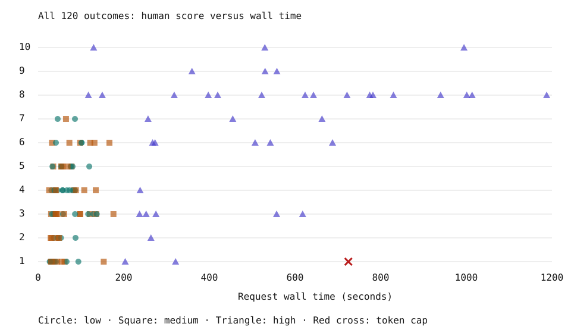

# Example run: eight Qwen3.8-Flash-Next quants on a laptop

**120 outcomes, 119 complete images, one token-cap failure.** These are observations from one prompt on one
machine, not a general model ranking. Generated on October 23–24, 2026; human grading followed with identities hidden.
The October 25 transparency update uses saved artifacts only: no new generation or grading.

[Every seed: score + time](SEEDS.md) · [Full gallery](GALLERY.md) · [AI judging](JUDGING.md) ·
[Non-pelican results](QUICK-EVAL.md) · [Methods](METHODS.md) · [Download/data dictionary](data/README.md)

## Observations

- Human mean across 40 outcomes per effort: **low 3.375, medium 3.625, high 6.500**.
  High has the largest overall mean, but not within every model: IQ3_XXS is **3.4 at medium versus 3.0 at high**.
- **Gyro-M high has the highest observed human mean, 8.8/10**, followed by turboderp EXL3 2.68 at 8.4.
  Five samples and one grader do not establish a definitive winner or equivalence between the leading models.
- Gyro-M's median high-effort wall time is **397.5 seconds**. The three leading EXL3 configurations take
  **643.1, 663.0 and 939.9 seconds**: ratios of **1.62, 1.67 and 2.36**, respectively.
  Those are observed system/configuration comparisons, not isolated quantization speedups.
- The 120 scored generations used **1,270,280 completion tokens** and **7.32 hours** of request wall time.
  The full sweep, including setup, checks and quick-eval, elapsed **8 h 38 m 47 s**.
  This is not a measurement of total preparation or all experiments combined.
- The saved AI judges generally use higher scores than the human and do not reproduce exactly the same ranking.
  Their **595 ratings cover 119 completed images**, not all 120 outcomes.

## High effort overview

“High” was requested; the servers resolved it to **xhigh**. Mean and median below include every attempted
scored outcome, including the failed tile. Score range shows observed variation, not a confidence interval.

| Model | n | Human mean | Score range | Median wall, s | Complete SVG | Token cap |
|---|---:|---:|---|---:|---:|---:|
| Gyro-M TQ2_0 | 5 | 8.8 | 7–10 | 397.5 | 5/5 | 0/5 |
| turboderp EXL3 2.68bpw h6 | 5 | 8.4 | 8–10 | 939.9 | 5/5 | 0/5 |
| EXL3-SC 3.05bpw h8 | 5 | 8.0 | 7–9 | 663.0 | 5/5 | 0/5 |
| EXL3-SC 2.05bpw h8 | 5 | 7.8 | 6–9 | 643.1 | 5/5 | 0/5 |
| GGUF IQ3_S | 5 | 6.0 | 1–8 | 454.6 | 4/5 | 1/5 |
| Gyro-S TQ1_0 | 5 | 5.4 | 2–8 | 237.0 | 5/5 | 0/5 |
| turboderp EXL3 2.18bpw h6 | 5 | 4.6 | 3–8 | 617.8 | 5/5 | 0/5 |
| GGUF IQ3_XXS | 5 | 3.0 | 1–6 | 252.4 | 5/5 | 0/5 |

All five scores **and their individual times**, for low, medium and high, are in [the seed tables](SEEDS.md).
The [CSV](data/sweep-1-cells.csv) also includes tokens, finish reason, render status and artifact paths.

Each point is one outcome; some overlap. The chart does not adjust for engine, model or reasoning budget,
so it is descriptive, not a causal fit. Exact values are in the seed tables and CSV.

## The ceiling hit: completion reliability versus finished-image quality

**IQ3_S / high / seed 33 / P231** reached the shared **49,152-token completion cap**.
First visible answer: **555.5 s**. Total request time: **724.6 s**, below the 2,700 s deadline.
The answer ends mid-path without a closing SVG tag; it was not repaired or rendered.

[Full raw response](data/sweep-1/raw/gguf-iq3_s-high-s33-a1.json) · [Failure tile](GALLERY.md#gguf-iq3_s-high-s33-p231)

| Population | Token-cap hits | Rate |
|---|---:|---:|
| IQ3_S high | 1/5 | 20% |
| All high effort | 1/40 | 2.5% |
| All scored outcomes | 1/120 | 0.83% |

These are sample rates, not precise estimates of long-run reliability. No scored request timed out or recorded
a transport error. Compatibility checks and warmups are excluded from these denominators.

IQ3_S high has a human mean of **6.0 over all five outcomes**. Among its four completed images the mean is **7.25**.
The latter is a completion-conditioned description, not a replacement leaderboard score. The human assigned the
failed tile a 1; the AI judges did not grade that tile, and no AI score has been imputed.

Six high-effort runs exceeded 32,768 tokens, including this failure. Equal maximum budgets do not mean equal
consumed budgets, and this dataset cannot tell us the quality of reruns at different limits.

## Read these limits before interpreting a ranking

- **One task, one human grader, five draws per model/effort.** Overall human scores are subjective and ordinal;
  their means are descriptive summaries. There are no human sub-scores or repeated human ratings here.
- **Two engines/configurations.** GGUF/Gyro used Strata v0.2.3 with engine 0.1.48; EXL3 used a locally modified
  fork with engine 0.1.45. Memory pressure, disk reads and engine settings are part of these results.
- **No unquantized reference.** The experiment compares configurations; it does not estimate absolute
  quantization degradation or establish a causal effect of quant format alone.
- **Seeds are replicate draws, not paired outputs across engines.** Do not connect identical seed numbers as
  matched observations or infer cross-engine determinism.
- **AI ratings are a separate measurement.** Five judges looking at the same image do not create five new
  generation samples, and shared model-family biases are possible.
- **Rendering changed, inference did not.** A 1.5 GiB address-space limit failed on one complete Gyro-M SVG.
  All outcomes were rerendered with a 4 GiB limit before the final gallery. This is separate from the IQ3_S cap hit.
- Historical p-values, confidence intervals and “statistically tied” wording are not carried forward:
  this release regenerates descriptive results, not the original inferential analysis. A nonsignificant test
  would not establish equivalence anyway.

## Help improve the benchmark

First inspect or regrade the [blind gallery](BLIND-GALLERY.md), compare [judge disagreements](AI-RESULTS.md),
or reproduce the tables with the [offline commands](data/README.md#reproduce-and-check).
Useful contributions include scoring rubrics, checks for denominator/attempt mistakes, independent human ratings,
and analysis of failure cases. Future multi-prompt or budget-controlled experiments should be new datasets, not
retroactive changes to this one. This update adds no inference workload.
